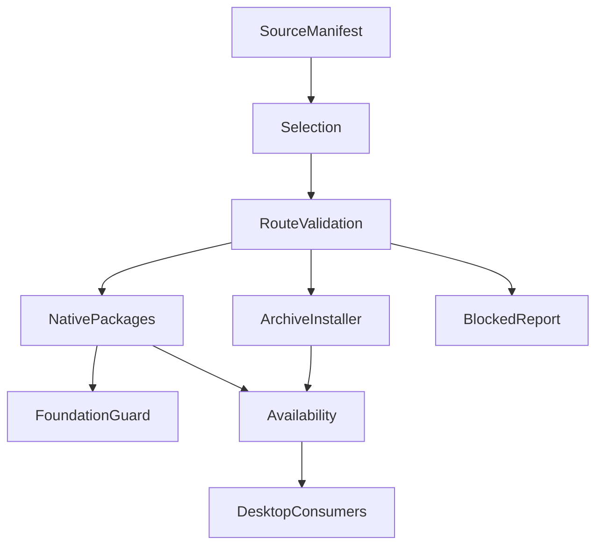

# Technical Design: Application Suite

## Overview

Preserve the complete source application inventory and provide permitted,
reviewable Ubuntu installation routes. A manifest separates source provenance,
selection and route validation from observed executable availability. Native
Ubuntu packages use the existing foundation guard. Reviewed standalone upstream
archives have a separate, explicit install contract; vendor repos and local
.deb installation remain blocked until their own compatible guarded route is
reviewed. This prevents treating a candidate package as a completed port.

### Goals

Account for every source app, install selected validated native apps, publish
accurate availability for desktop/tool consumers, and preserve local state.

### Non-Goals

No arbitrary installer runner, distro conversion, forced installation of every
role-specific client, source host-role purges, secret migration, or settings
owned by shell, fonts, containers, themes or compositor specs.

## Boundary Commitments

### This Spec Owns

Source disposition manifest, native application binaries and selected standalone
release tools, route eligibility, minimal application-specific settings and
availability reports. Includes btop/htop and the Neovim executable where requested;
neighboring specs own configurations. Includes rclone binary; shell owns mounts.

### Out of Boundary

Node/npm through apt, Podman/podman-tui, font packages and fontconfig, compositor
packages/services, terminal configurations, editor themes and nvim-simple.
Existing foundation CLI tools remain foundation-owned until a later explicit
integration moves ownership; this feature detects them rather than duplicates
installation. No direct changes to root deploy.py in feature tasks.

### Allowed Dependencies

Foundation's `PackageRequest(packages: tuple[str, ...], source='ubuntu')`,
`validate_request`, `inspect_plan`, `install_packages`; local dpkg/apt read-only
metadata and native desktop-user execution. Only exact reviewed archive entries
use the separately specified ArtifactInstaller. The PackageRequest source union
is not extended or bypassed. Downstream consumers read this spec's report.

### Revalidation Triggers

Source revision, application selection, repository origin, package/version,
artifact digest/architecture, executable name or availability-schema changes.
Changed packages or archives invalidate prior native/script compatibility review.

## Architecture

### Existing Architecture Analysis

Source `tasks/apps.py` installs Debian package lists, creates vendor repositories,
installs pinned .debs and release archives, and purges some client-role apps on
other hosts. Local Ubuntu indexes expose most native tools but no candidates
for the source names chromium/chromium-driver. Existing Vivaldi metadata is not
proof of Ubuntu origin. Ghostty's source forky build is not a compatible Ubuntu
artifact merely because it is amd64.

### Architecture Pattern & Boundary Map



Data → validation → installers → feature deploy entry point. Consumers do not
install packages as a side effect of querying availability. A source inventory
is committed and survives loss of the temporary upstream checkout.

### Technology Stack

| Layer | Choice | Role |
| --- | --- | --- |
| Provisioning | Existing pyinfra 3.10.0 | Local state operations |
| Native packages | Ubuntu 26.04 configured repositories | Foundation guarded route |
| Inventory | JSON, Python typed models | No new runtime dependency |
| Release binaries | Pinned upstream archives | Selected reviewed entries only |

## File Structure Plan

- `config/applications/source-manifest.json` — every source entry with source
  path/revision, owner, capability, route and disposition.
- `config/applications/selection.json` — explicit selected required/optional IDs.
- `config/applications/artifacts.json` — reviewed selected archive pins and
  compatibility evidence; no credentials or arbitrary shell commands.
- `manage/applications.py` — manifest validation, selection and availability
  observations; no package-policy ownership.
- `manage/application_artifacts.py` — integrity, archive validation and atomic
  replacement for reviewed standalone binaries only.
- `tasks/applications.py` — optional feature entry point and native install
  orchestration, consuming foundation policy/preflight.
- `docs/backlog.md` — source installer references and explicit deferred LibreOffice/Carlito/Craft scope; no office configuration artifact is generated in current work.
- `tests/test_applications.py` — source/owner/status/selection/report behavior.
- `tests/test_application_artifacts.py` — checksum, archive/path, replacement
  and partial-failure verification.
- `docs/application-routes.md` — operator-facing generated route disposition.

`source-inventory.md` and `package-candidates.txt` in this spec are investigation
artifacts, not the runtime manifest. Feature integration owns these new paths;
foundation/root deploy modifications stay in foundation integration tasks.

## System Flows

Selection first validates known IDs, unique ownership and route readiness.
Unselected optional entries appear in the report without installation. A selected
required blocked entry fails before installations; it does not quietly vanish.
Read-only availability observations remain available even when installation is
blocked. Native operations call foundation policy before apt mutation. Archive
downloads never run during preview.

For repeated installation, compare selected version/digest and actual executable
state. A marker without a matching executable is insufficient. No source purge
branches are ported. The report includes pending local licenses/auth separately.

## Requirements Traceability

| Requirement | Summary | Components | Interfaces | Flows |
| --- | --- | --- | --- | --- |
| 1.1, 1.2, 1.3, 1.4 | Complete source disposition | ApplicationCatalog | ManifestEntry | Inventory |
| 2.1, 2.2 | Guarded native installation | NativeApplications | PackageRequest | Native apply |
| 2.3, 2.4 | Integrity and route gates | RouteValidation, ArtifactInstaller | ArtifactEntry | Eligibility |
| 3.1, 3.4 | Executables and verified status | NativeApplications, Availability | AvailabilityReport | Observe |
| 3.2, 3.3 | Deferred office and Craft inventory | ApplicationCatalog | backlog disposition | Inventory |
| 4.1, 4.2, 4.3, 4.4 | Preservation and repeatability | NativeApplications, ArtifactInstaller | ownership/backups | Repeat apply |
| 5.1, 5.2, 5.3, 5.4 | Preview/results/scope | FeatureDeploy, Availability | CLI/report | Preview/apply |

## Components and Interfaces

| Component | Files | Intent | Requirements | Dependencies | Contract |
| --- | --- | --- | --- | --- | --- |
| ApplicationCatalog | source/selection JSON, manage/applications.py | Source coverage and ownership | 1.1, 1.2, 1.3, 1.4 | source index P0 external | State |
| RouteValidation | manage/applications.py | Permit only reviewed routes | 2.2, 2.3, 2.4 | foundation P0 outbound | Service |
| NativeApplications | tasks/applications.py, backlog disposition | Selected native apps/settings | 2.1, 3.1, 3.2, 3.3, 4.1, 4.2, 4.3, 4.4 | apt guard P0 outbound | Batch |
| ArtifactInstaller | manage/application_artifacts.py, artifacts JSON | Reviewed archive binary | 2.3, 3.1, 4.1, 4.2, 4.3, 4.4 | HTTPS/upstream P0 external | Batch |
| Availability | manage/applications.py | Actual local capabilities | 3.4, 5.2, 5.3 | executable probes P0 external | Service |
| FeatureDeploy | tasks/applications.py | Optional feature entry point | 5.1, 5.2, 5.4 | preflight P0 outbound | Batch |

### ApplicationCatalog and Availability

```python
from dataclasses import dataclass
from typing import Literal

@dataclass(frozen=True)
class ApplicationStatus:
    id: str
    owner: str
    disposition: Literal['native', 'archive', 'delegated', 'optional', 'excluded', 'blocked']
    selected: bool
    installed_version: str | None
    executable: str | None
    available: bool
    reason: str | None

def observe_applications() -> tuple[ApplicationStatus, ...]: ...
```

Published report: `$XDG_STATE_HOME/t2-mac-kde/applications.json`, default
`~/.local/state/t2-mac-kde/applications.json`, schema_version=1 and entries keyed
by stable application ID. Observation itself is read-only; report writing is
an explicit apply/report action. In preview print statuses without changing
this file. Consumers must re-probe the resolved executable before launching;
missing/stale report is unknown, not proof of availability.

Each source package/release/client-map key appears exactly once. Delegated
entries name the owning spec. `nodejs`/`npm` are excluded system packages,
replaced by foundation nvm. `podman-tui` delegates to containers. Public font
packages delegate to desktop-fonts. Native tools already in foundation's list
are observed as delegated, not installed twice. Terminal binaries are separate
from terminal/theme configuration.

### RouteValidation and NativeApplications

Inspect effective origin and dependencies for each selected exact native
package. Ubuntu-origin entries use the exact shared PackageRequest contract.
Local vendor packages do not become accepted by relabeling them as Ubuntu.
Reject Snap/Flatpak transitions, including substituting chromium-browser for
the missing Debian package names. Alternative browser artifacts remain blocked
until their route is reviewed; never substitute a different browser silently.

Initial native-route candidates are the source Ubuntu-available CLI/editor,
office, terminal and viewer packages recorded in source-inventory.md. Candidate
versions are research only; re-resolve and review selected versions before apply.
LibreOffice Writer/Calc, language packs, dictionaries, Carlito and the admin
XCD are deferred backlog. Craft suite installer entries are deferred too.
Selection validation rejects attempting to install/configure these entries in
the current phase, with a backlog reason; inventory records remain visible.
`fd` compatibility uses a non-conflicting user-owned link only if absent; existing
commands are never overwritten. Other app settings are not inherited wholesale.

### Auxiliary terminal and office package ownership

Application-suite is the installation producer for native `terminator` and
`xfe` from source desktop.py as well as the source apps.py inventory. The
explicit `hyprland-core` selection profile requires both. Publish stable IDs
`terminator` and `xfe` in the availability report; verify `terminator` and
`remotinator` executables and required configobj/GI/GTK/VTE runtime imports.
Terminator2.1.5-1 declares these native dependencies in local package metadata;
install them through guarded apt resolution rather than a theme-side installer.
GI is a shared native dependency also required by desktop menus, not a shared
configuration owner. Themes owns terminal profiles/menu/CSS; desktop consumes
executables and never installs/configures Terminator separately.

`fonts-crosextra-carlito` belongs to application's deferred LibreOffice backlog,
not desktop-fonts or the current native installation profile. It is an office runtime font dependency and does not confer
ownership of the Nerd/Fixedsys/fontconfig feature. `cliphist` installation belongs
to desktop; `x11-xserver-utils` belongs to fonts for xset. Application-suite keeps
these delegated entries in source inventory and observes availability only.

### ArtifactInstaller

Eligible archive records contain ID, exact upstream version, HTTPS URL, SHA-256,
architecture, fixed archive member path, destination basename, native runtime
dependency names and recorded compatibility review. Source kubectl/helm/k9s/ktop,
zellij/upmd/bw/rc/rclone are candidates, not assumed selected or validated.
Defaults and every source URL/digest must be captured in the committed manifest
at implementation rather than fetched from a moving source branch.

Validate native dependencies using foundation guard. Download into a temporary
user directory, verify checksum, reject absolute/traversal paths and escaping
links, extract only the fixed reviewed member, and atomically replace an owned
binary under `~/.local/bin`. Preserve conflicting unmanaged binaries and report
the conflict. No arbitrary `find | head` executable selection, maintainer scripts,
sudo installer, or mutation outside the owned paths. Backup an owned prior version
for restoration and verify the selected executable's version after replacement.

This contract handles standalone archives only. Vendor apt repositories and
.deb artifacts (Sublime, Typora, Vivaldi, Obsidian, Bitwarden desktop, Ghostty and
client-role .debs) are explicitly accounted for but not installed by this route.
Their selection remains blocked until a separately reviewed compatible installer
contract is added. The source's Debian forky Ghostty package is rejected.
That is a visible route limitation, not a claim that these applications have
already been ported. Downstream feature design may use existing validated local
executables or compatible alternative native candidates without inventing installs.

## Data Models

Source manifests record provenance separately from resolved version and runtime
observation. IDs remain stable when routes change. Selection has required and
optional ID sets; no host-name role implicitly installs/purges applications.
A required selection's unresolved state is a blocking error. Optional-unselected
states are reported. Credentials and licenses never enter manifests/reports.

## Error Handling

Fail selected required work on unknown selection, unreviewed route, prohibited
transition, missing compatible artifact, dependency failure, checksum mismatch,
archive escape, unmanaged destination conflict or failed executable check.
Report exact app and reason; leave prior owned executable restored on replacement
failure. Earlier successful apps are reported individually; no atomicity claim
across unrelated apt operations. No Snap/Flatpak or vendor-repo fallback.

## Testing Strategy

- 1.1–1.4: mechanically compare manifest IDs with source AST package lists and
  configured release/client maps; no missing entries or double ownership.
- 2.1–2.4: fixture native origin, Snap transitions, missing Chromium candidates,
  vendor origin and checksum/architecture mismatch; selected blocked apps fail
  before mutation, optional unselected entries remain visible.
- 3.1–3.4: disposable native app install, executable probe and stale report cases;
  office/Craft entries retain backlog status without installer actions.
- 4.1–4.4: absent/present/conflicting executables, preserve unselected apps,
  archive restoration, unchanged deferred apps and unchanged second apply.
- 5.1–5.4: preview prohibits downloads/writes; selected-app failures stay nonzero,
  reports distinguish pending/installed states; protected host write targets absent.

## Migration Strategy

Start with complete inventory and observations. Select the agreed source CLI
capabilities and explicitly supplied app profiles; do not silently select every
client app. Add reviewed native routes, then reviewed archive routes. Keep
unsupported vendor/.deb entries in the report and route-evaluation follow-up,
without claiming their installation. Feature execution is optional and does not
modify root deployment or the user's login/GPU baseline.

## T2 hardware boundary clarification

All app plans preserve the fresh T2 install per t2-hardware-policy.md, including
kernel/initramfs/firmware and touch-bar/microphone/camera support. KDE stays
dormant; no Plasma session is launched by this spec. App availability remains
separate from hardware functionality; live audio/camera tests are pending.

## Protected-system no-go

Read protected-system-boundary.md. Reject application dependency transactions
that alter protected cryptsetup/LUKS/LVM, fstab, kernel/headers/modules,
bootloader or initramfs/mkinitcpio state, including indirect triggers. Archive
installation owns user binaries only; no post-install commands or boot rebuilds.
This is a hard eligibility gate, not a rollback permission.

## Owner-directed backlog amendment

LibreOffice (including language support, tabbed UI and Carlito) and the Craft
suite installer are explicitly deferred. They remain source-inventory entries
using optional disposition with reason=backlog and are not selectable for current
installation. Existing installations are neither purged nor reconfigured.
The original Craft installer references are preserved in docs/backlog.md.
This supersedes earlier office-profile installation wording in source research.
