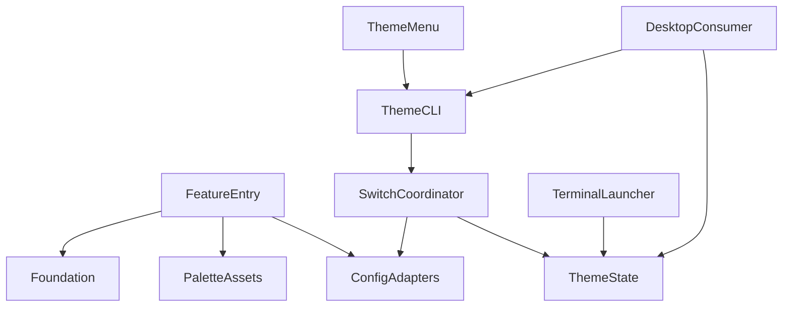

# Design Document

## Overview
Port the actual source palettes and application coordination through optional locked local pyinfra execution. Preserve the published desktop consumer seam and make application compatibility an explicit per-target result. This specification defines documents only; no runtime acceptance is claimed.

### Goals
Reuse all five palette assets, preserve application preferences, and provide standalone switching, repeatability and scoped recovery.

### Non-Goals
Application installation, shell/editor-base ownership, Waybar widgets, compositor effects, KDE appearance changes and boot/storage/hardware policy changes.

## Boundary Commitments

### This Spec Owns
- Palette manifest, original/generated palette files, source-derived generators and terminal configuration adapters.
- `/usr/local/bin/hypr-term`, `~/.local/bin/hypr-termtheme`, compatibility selection and target status.
- Terminator profiles/plugin and scoped GTK tab style; Ghostty/foot config inclusions; xfce4-terminal source property set.
- Theme/font keys and owned assets for btop/Claude/Sublime/Code/Positron, optional constant Chromium cream policy, and `~/.config/nvim/plugin/debian-hypr-theme.lua` only.

### Out of Boundary
Do not edit shared `deploy.py`, shell blocks, Neovim base files/plugins, application installation manifests, desktop widget/configuration, global GTK theme, KDE decoration, SDDM, GPU units or protected state. Application-suite owns executables; shell owns nvim-simple including Berg/airline/ToggleTheme APIs and excludes this bridge during updates/restoration. Desktop owns its session-scoped bar signal receiver and terminal launch binding.

### Allowed Dependencies
Foundation `manage.preflight.validate_local_context()` and `manage.packages` APIs (`PackageRequest(packages: tuple[str, ...], source: Literal['ubuntu'])`, `validate_request`, `inspect_plan -> PackagePlan(installs, removals)`, `install_packages`), Python >=3.11, locked pyinfra 3.10.0. Font manifest and installed family reports from desktop-fonts; shell's validated nvim-simple base; application report `$XDG_STATE_HOME/t2-mac-kde/applications.json`, schema_version 1 with stable IDs, followed by executable re-probe. Theme runtime uses system Python standard library and source shell launchers; no new Node/Python environment or moving dependency is needed. Terminator/configobj/GI, xfconf and application runtimes come from their application producer; missing prerequisites block only selected targets. No mandatory optional application install.

### Revalidation Triggers
CLI/state/order or exit changes require desktop/RDP consumer review. Source pin, palette generation, fonts/Berg APIs, app version/config grammar, XDG/config paths, foundation guards and application report schema changes require affected adapter review. Ubuntu Hyprland remains packaged 0.53.3 with compatible packaged hyprbars; theme runtime neither builds nor depends on that compositor.

## Architecture

### Existing Architecture Analysis
Source scripts overwrite state before app updates, parse JSONC using regex, signal broad process names and delete Ghostty's old config. These are explicit adaptations: validate/stage first, preserve syntax/unrelated bytes, restrict reload targets and retain conflicting old configs. The source's xfce4-terminal block is cobalt-only and is retained as such; it is not misrepresented as a source switching target.

### Architecture Pattern & Boundary Map
Dependency direction: immutable assets/types → preserving adapters and state → switch coordinator → CLI/menu/feature entry. Adapters import no desktop or application installer. One narrow adapter contract generalizes actual target differences without a plugin framework.

### Technology Stack
| Layer | Choice/version | Responsibility |
| --- | --- | --- |
| Provision | Existing uv/pyinfra 3.10.0 | Guarded optional feature operations |
| Runtime | POSIX launcher + Python >=3.11 stdlib | Validated selection, token-preserving edits, receipts |
| Assets | Source revision a1c09ec3f02a98b7c6a4641f907108a2ad080993 | Five palettes, original generators |
| Editors | Source local extension 1.0.0, engine ^1.80.0 | Code/Positron theme contribution |
| Sessions | Installed native app interfaces | Scoped reload where verified |

## File Structure Plan
Future implementation paths; no existing files need modification in this spec.

| Path | Component/responsibility |
| --- | --- |
| `group_data/themes.py` | PaletteAssets: typed selection, immutable file/blob/digest manifest |
| `files/terminator/config`, `files/terminator/plugins/theme_menu.py`, `files/gtk-3.0/terminator-tabs.css` | TerminalIntegration: source profiles/plugin/scoped tab CSS |
| `files/ghostty/`, `files/foot/`, `files/themes/`, `files/sublime/`, `files/vscode/debian-hypr-themes/` | PaletteAssets: original assets and deterministic outputs |
| `tools/themegen.py`, `tools/vscodetheme.py` | PaletteAssets: source-derived offline generation |
| `files/bin/hypr-term`, `files/bin/hypr-termtheme` | ThemeCLI: thin fixed-path executable interfaces |
| `files/lib/t2-mac-kde/themes.py` | SwitchCoordinator: installed user runtime implementation under `~/.local/lib/t2-mac-kde/themes.py` |
| `manage/theme_config.py` | ConfigAdapters: provisioning-safe preserving config operations, same source installed as runtime library sibling |
| `manage/theme_state.py` | ThemeState: locking, receipts, staging/journal/recovery, installed as runtime library sibling |
| `files/nvim/plugin/debian-hypr-theme.lua` | EditorBridge: standalone source-derived startup integration |
| `tasks/themes.py`, `deploy_themes.py` | FeatureEntry: optional orchestration without shared root deploy edits |
| `tests/test_theme_assets.py`, `tests/test_theme_config.py`, `tests/test_theme_state.py`, `tests/test_theme_cli.py` | Components' fixture checks |
| `tests/integration/test_themes.py` | FeatureEntry integration and explicit application acceptance checks |

## Components and Interfaces
| Component | Intent | Requirements | Dependencies and contracts |
| --- | --- | --- | --- |
| PaletteAssets | Pinned complete asset set | 1.1, 1.2, 1.3 | Source P0 external; fonts P1 external; batch/state |
| ConfigAdapters | Preserve settings while changing owned keys | 3.2, 3.3, 3.5, 3.6, 4.1, 4.2 | Installed app P0 external; assets P0 outbound; service |
| TerminalIntegration | Profiles/menu/tab styling | 3.1 | Terminator/GI P0 external; CLI P0 outbound; batch/event |
| EditorBridge | Berg startup choice | 3.4 | Shell editor base P0 external; state P0 outbound; event |
| ThemeState | Serialized recoverable selection | 2.1, 2.2, 4.3, 4.4 | User filesystem P0 external; state/service |
| SwitchCoordinator | Target application and outcomes | 2.1, 2.2, 2.4, 2.5, 5.3 | Adapters/state P0 outbound; service |
| ThemeCLI | Stable producer seam | 2.3, 2.4, 2.5 | Terminal executable P0 external; coordinator P0 outbound; CLI |
| FeatureEntry | Preview/provision/recover/evidence | 5.1, 5.2, 5.3, 5.4 | Foundation P0 external; components P0 outbound; batch |

### PaletteAssets
Inventory every pinned file using `source-assets.json`; manifest contains source path, Git blob SHA1, independently computed SHA256, destination pattern, target and disposition. Acquisition verifies immutable revision and bytes; license review precedes redistribution. Do not fetch source secrets or licensed Berkeley Mono. Generators run offline in staging, read the actual Terminator profiles/tab dictionary and actual Sublime/Ghostty palette files, then compare deterministic output with audited checked-in files. Record intentional adaptations and generated output digests separately.

| Profile in cycle order | Asset name | Background / foreground | Font |
| --- | --- | --- | --- |
| default | cobalt | #003e97 / #fff8f0 | FiraCode Nerd Font 13 |
| navy | navy | #1a2a3f / #fff8f0 | FiraCode Nerd Font 11 |
| fixedsys | fixedsys | #1f233c / #ffa348 | Berkeley Mono 12; unavailable private family resolves through verified public monospace fallback |
| cream | cream | #fff8f0 / #2b4570 | FiraCode Nerd Font 13 |
| petrol | petrol | #002b36 / #ff911d | Fixedsys Core 12 |

Preserve full source 16-color ANSI arrays, cursor overrides, tab dictionary and syntax rules rather than recreating palettes from these three columns. Petrol cursor is #62a0ea with #000000 text; cream is the only light palette. Record `fc-match` actual fallback when Berkeley is absent without silently installing private fonts or changing source profile identity.

### ThemeCLI and producer contract
- `/usr/local/bin/hypr-term [terminal arguments...]`: run as owner, resolve validated compatibility profile and execute native `terminator -p <profile>` with original argument vector. Terminator is the source default, no hidden alternate terminal. Missing executable fails127, invalid state fails1 with repair guidance, launched exit/signal behavior is preserved by exec. No sudo, compositor startup or library environment injection. Desktop adapts Fuzzel execute semantics through this helper.
- `~/.local/bin/hypr-termtheme <profile>|next|prev|apply`: fixed allowed source profiles `default navy fixedsys cream petrol`. Missing argument retains source `next`; `next` and `prev` wrap in that order. `apply` keeps selection and omits source live Terminator/Waybar/notification actions while reapplying eligible app settings. Unknown profile/extra arguments return2 before writes. Runtime/config/lock/apply failure returns1; success returns0 with skipped/pending outcomes visible.
- Fixed compatibility path `~/.local/state/terminator-profile`, independent of XDG state override, one newline-terminated known source profile. Missing file means `default`, mapping to cobalt; malformed/unknown/multiline state is an error, never an arbitrary profile or path. Desktop reads only and never writes. CLI/state source contract does not require a compositor.
- After a committed non-apply change, optionally send RTMIN+10 only to a verified same-user current-session Waybar receiver. With no unambiguous receiver, skip; never broad `pkill -x waybar`. Hyprland notification is best-effort only for an explicitly identified inherited active session, never select by newest runtime directory. Missing consumer or notification failure cannot turn successful config commit into failure.

### ConfigAdapters
`probe(target: str) -> TargetCapability`; `prepare(target: str, profile: str) -> PreparedChange`; `publish(change: PreparedChange) -> TargetResult`; `reload(target: str) -> TargetResult`. Frozen typed records use a target literal, absolute validated path, input/output digest, owned keys, compatibility evidence and outcome `applied|unchanged|skipped|incompatible|failed|pending-live`. No arbitrary command string inputs. Profile and paths are validated before lookup.

Eligibility requires explicit target selection, actual executable re-probe and verified installed-version grammar/API. Absent/unselected targets create no app directories. Unsupported installed app configs remain byte-identical and are reported incompatible. All compatible selected targets enter the coordinated file transaction; a preparation/publish error aborts that transaction. Unavailable/incompatible targets are excluded with diagnostics rather than blocking unrelated eligible apps. Selected core Terminator requires installed profile support before provisioning the launcher/menu. Read existing app configuration without logging private contents.

| Target | Source assets / owned setting seam | Activation and compatibility |
| --- | --- | --- |
| Terminator | `~/.config/terminator/config`: five profiles and source global tab/plugin keys; `plugins/theme_menu.py`; own scoped GTK import | Preserve all other profiles/layouts/plugins/keys; fail ambiguous collisions unless backed up/adopted. `remotinator switch_profile_all -p <profile>` only on validated owner user bus; no running instance means next launch. Plugin re-monitors parent directory so atomic state/config replacement remains observable. Menu lists the five supported managed profiles only. |
| Ghostty | Five `themes/<palette>` and `.css`, current `theme`, additive include in version-supported base config | Source `config.ghostty` since1.2.3; earlier `config` is never deleted. Probe actual version/options including gtk-custom-css; unsupported keys mean incompatible until explicitly adapted. SIGUSR2 only to verified owner app processes after API verification; new windows accepted separately. |
| foot | Five `themes/<palette>.ini`, current `theme.ini`, additive `foot.ini` include | Source generator uses `[colors-dark]` and cursor grammar for foot>=1.26. For older compatible installed releases, generate documented installed-version dialect from same colors after parser validation; otherwise incompatible, preserve config. New windows only, no claimed live switch. |
| xfce4-terminal | Source cobalt property set in tasks/shell.py, including unsafe-paste dialog=true | Query existing property types on the actual inherited owner session bus; do not fabricate bus address or start a daemon. Snapshot per-property values/existence; restore only unchanged managed values. Missing bus is pending-live, no XML overwrite of active xfconf. This is a separate provisioning transaction and not in palette cycles. |
| btop | Five `~/.config/btop/themes/<palette>.theme`; only `color_theme` in btop.conf | Preserve other lines; add missing key once. Source transparent main_bg. Verified owner SIGUSR2 reload or pending-live. |
| Claude Code | Five `~/.claude/themes/<palette>.json`; only `theme=custom:<palette>` in settings.json | Validate installed custom theme support/schema first; no assumption that every Claude release supports source extensions. Unsupported versions stay untouched. App-driven reload only when supported. |
| Sublime | Five User `debian-hypr-<palette>.sublime-color-scheme`; color_scheme, font_face/font_size; Adaptive theme only when absent | Preserve existing theme preference; settings reload expected but actual running app acceptance required. |
| Code / Positron | Each private local `extensions/debian-hypr.debian-hypr-themes-1.0.0` directory with five actual theme JSONs; User settings workbench.colorTheme, editor/terminal fontFamily/fontSize | Require extension engine/contribution compatibility in each actual app; label `debian-hypr <CapitalizedPalette>`. Preserve telemetry/update/titlebar/recommendation settings: those source app policies are outside theme ownership. No directory-wide sync deletion. |
| Neovim | Independent bridge plugin, reads compatibility state | Cream→berg-light, others→berg on VimEnter; shell supplies both files and manual ToggleTheme. No live buffer switching. Missing base/API means skip/error with evidence, no replacement init.vim. |
| Chromium | Constant `{BrowserThemeColor:#fff8f0, BrowserColorScheme:device}` in dedicated native policy file | Explicit opt-in plus actual compatible native browser path/policy schema; inspect competing policy before write. Chromium-specific `/etc/chromium/policies/managed/debian-hypr-theme.json` only if consumed by that installed browser; do not copy it to unrelated vendor paths. Not cycled; policy acceptance shown by browser policy UI. No Snap route. |

JSON/JSONC editing is syntax aware: tokenize quoted strings/escapes, whitespace, line/block comments, punctuation and values; build root member spans, reject duplicate owned keys or malformed/unsupported syntax, replace only owned value spans and insert missing members with valid comma handling. Preserve comments, ordering, unrelated value bytes, encoding/newline/indentation. Reparse output and compare unrelated member bytes before staging. Regex comment stripping plus whole-file json.dump is forbidden. Plain JSON uses the same preserving edit engine; existing missing files may be created minimally only for eligible apps. INI-like/GTK edits preserve unrelated bytes using exact sections/marked import, with parser validation. Unsafe symlink, foreign ownership or ambiguous include conflicts block the target.

### ThemeState and SwitchCoordinator
Private state `$XDG_STATE_HOME/t2-mac-kde/themes/` contains schema_version1 receipts/status/journal; default `~/.local/state`. Backups mode0600, dirs0700, logs contain paths/digests/status only. Compatibility file stays fixed as above. Private advisory nonblocking lock serializes provision, switch, apply and restoration; busy returns1. The launcher reads an atomically committed state without lock; it never observes partial state content.

Before any file changes, recover any interrupted journal, validate targets and all desired settings, stage files on their destination filesystems and capture originals/digests. Recheck digests immediately before replacement. Persist journal before publication, publish each validated file, then atomically publish compatibility selection last and update receipt/status. Cross-directory atomicity is impossible: the journal records incomplete generations; recovery rolls back only files still matching staged digests before another switch. If rollback conflicts with later edits, stop and report, leaving conflict bytes untouched. File publication failure retains old selection. No signals are sent until file transaction commits. External live app actions cannot be atomic with filesystem: reload failure after commit reports pending-live and does not pretend to roll back visible app state. Next `apply` repairs owned file state. Applying unchanged selection/files makes no unnecessary writes or reload signals.

Scoped restore consumes receipts with original existence, backup, old/new digest and per-key preimage. Restore only current matching owned changes; preserve intervening unrelated edits with safe key-level reversal, and refuse owned-key conflicts. Remove newly created files only when entire digest matches; retain unowned extra extension/assets. Restore xfconf properties by compare-and-set on inherited bus; no bus means pending restoration. Chromium policy restoration is privileged but equally scoped. Never purge packages or restore protected files.

### FeatureEntry
`uv run --locked pyinfra @local deploy_themes.py --dry` previews; apply omits `--dry` and uses foundation interactive sudo only for `/usr/local/bin` and explicitly selected native policy path. Foundation preflight/guard must already exist; no direct apt or substitute guard. Feature normally installs no packages; missing app prerequisites go to application producer. Report status per target and retained source/adaptation digest. Dry mode neither acquires live lock nor writes assets/backups/state nor calls reload/xfconf setters. Preserve installed dormant KDE, complete source keyboard mapping, AppleT2 UCM/PipeWire/WirePlumber, firmware and all T2 drivers. Reject protected package/hook effects, unknown triggers, Snap/Flatpak; no cryptsetup/LUKS/LVM, fstab/swap/resume, kernel/modules/headers, bootloader or initramfs/mkinitcpio writes/regeneration. No autologin, reboot, service restart or keyboard changes.

## Requirements Traceability
| Requirement | Summary | Components | Interfaces | Flows |
| --- | --- | --- | --- | --- |
| 1.1, 1.2, 1.3 | Actual palette/font inventory | PaletteAssets | Pinned manifest/generators | Stage/compare |
| 2.1, 2.2 | Coordinated selection | SwitchCoordinator, ThemeState | CLI, journal | Validate/stage/commit |
| 2.3, 2.4, 2.5 | Stable standalone commands | ThemeCLI | Producer CLI/state | Launch/switch |
| 3.1 | Source terminal UX | TerminalIntegration | Profiles/menu/Gio | Change/new launch |
| 3.2, 3.3, 3.5, 3.6 | Eligible target themes | ConfigAdapters | Owned keys/capability probe | Apply/skip |
| 3.4 | Next-start Berg choice | EditorBridge | VimEnter/state | Start/manual toggle |
| 4.1, 4.2 | Preserve configs | ConfigAdapters | Token spans/digests | Prepare/conflict |
| 4.3, 4.4 | Scoped recovery | ThemeState | Journal/receipt | Recover/restore |
| 5.1, 5.2, 5.3, 5.4 | Safe execution/evidence | FeatureEntry | Foundation, outcomes | Preview/apply/validate |

## Error Handling
Invalid selection exits2; corrupt state, unsafe ownership, locked/incomplete recovery and required eligible write failures exit1 with target/path/reason. Missing optional processes/compositor/bus have explicit skipped or pending-live status. Unsupported apps remain unchanged and incompatible; no success claim for them. Never log tokens or full user configuration. Unexpected subprocess failure is not swallowed by blanket success handling.

## Testing Strategy
- 1.1–1.3: verify every source blob/hash, five profile order/colors/16 ANSI entries/cursor/tab fonts and all 16 syntax rules per editor theme; run both generators offline and compare source outputs, then installed-version adaptations. Query actual fallback for absent Berkeley without acquiring it.
- 2.1–2.5: stub terminal proves argument boundaries/exit propagation; exercise next/prev wrapping, apply, empty argument compatibility, invalid/extra arguments, missing/malformed state, no compositor and no bar. App writes/success state remain unchanged on invalid inputs.
- 3.1: real Terminator menu/profile switch and atomic rename watcher repeated twice; verify original profiles/layouts/other plugins remain, current/new windows and tab colors/fonts match. Source GTK selectors must not alter unrelated GTK applications.
- 3.2–3.6: each adapter tests installed/unselected/missing/unsupported grammar and unique paths; no optional app directories or installs when excluded. Verify actual foot parser dialect, Ghostty config diagnostics, Code/Positron extension discovery/theme labels, btop/Claude support, Sublime font/theme selection; xfconf property readback and unsafe paste; Chromium policy UI and constant cream. Real windows required for live claims.
- 3.4: bounded nvim headless startup selects light for cream/dark otherwise using shell-owned base; F4/ToggleTheme still works. Shell update and restore preserve bridge, theme restore preserves shell base. Live editor appearance is separate acceptance.
- 4.1–4.4: fixtures include JSONC inline/block comments, URLs containing //, escaped quotes, trailing commas, nested settings, duplicate owned keys, invalid syntax, absent keys/files, CRLF, symlinks and concurrent editor saves. Assert unchanged unrelated bytes and incompatible target entire files.
- 4.3–4.4: inject failure at every publish/state commit, terminate between file replacements and recover journal; two switches/restore contend on lock. Prior selection remains until commit; edited owned files conflict without overwrite; external reload failure reports pending-live after commit.
- 5.1–5.4: disposable-home dry/apply/reapply/scoped-restore snapshots prove preview/no-op preservation and exact reports. Guard fixtures reject prohibited/protected package and trigger paths. Capture accessible nonsecret baseline hashes and compare KDE/login/keyboard/audio/T2/protected state unchanged; actual physical input, Option+L/@/Super and hardware behavior remain host acceptance, not inferred from hashes.

## Migration Strategy
Review immutable inputs, probe selected installed app capabilities, preview and retain originals, provision owned assets/independent plugin/config seams, then apply initial selection. Validate without compositor first, then explicit native desktop integration. No original config deletion or source VM settings. Report unsupported optional targets individually; restoration is receipt-scoped and never changes boot/storage/hardware state.
