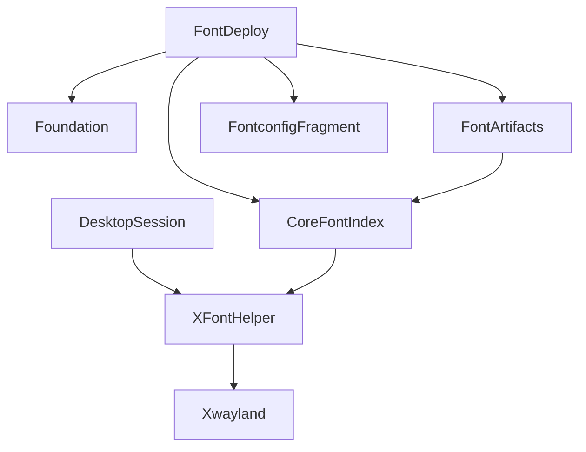

# Technical Design: Desktop Fonts

## Overview
Port the source's public font assets and font lookup behavior through the existing locked pyinfra environment. Keep font installation independent of Hyprland installation: core font files and the helper can be prepared before any compositor exists. This specification delivers fonts and their lookup contracts; desktop and application specs consume those contracts.

### Goals
Provide checksum-verified Nerd/Fixedsys fonts, user-preserving fontconfig integration, and bounded Xwayland core-font registration. Support non-mutating preview, repeatability and scoped restoration.

### Non-Goals
Private asset extraction, application font selection, compositor startup edits, theme controls, KDE/login changes or graphics policy.

## Boundary Commitments

### This Spec Owns
- Public font manifest, acquisition, owned destination files and font cache invalidation.
- One additive user fontconfig fragment and rendering-mode input.
- Dedicated X11 core-font directory and `/usr/local/bin/hypr-xfonts` executable.
- Optional font deploy entry point, validation and restoration operations.

### Out of Boundary
Hyprland owns invoking the helper at session start and after a new Xwayland instance. Applications, shells and themes own their family selections. Foundation owns all shared preflight/package guard code and root deploy integration. This feature must not edit `deploy.py`, shared manifests, existing user `fonts.conf`, private font directories, KDE settings or boot/GPU units.

### Allowed Dependencies
Python >=3.11, uv locked pyinfra 3.10.0 and foundation's `manage.preflight`/`manage.packages`; Ubuntu native `fontconfig`, `xfonts-utils`, `x11-xserver-utils`, `fonts-noto-color-emoji`, `fonts-symbola`; `x11-utils` for validation. Standard Python archive/hash/path support avoids a new downloader runtime. Xwayland is supplied by desktop and is needed only for session validation.

### Revalidation Triggers
Recheck consumers if helper path, font directory, exit semantics, wait limit, installed family/style names, source pins, rendering behavior or foundation API changes. New Ubuntu release/index/policy data requires new package-plan review. Display server changes require fresh core-font acceptance.

## Architecture

### Existing Architecture Analysis
Local code currently contains only Node/CLI pyinfra deploys; foundation's reviewed guard is designed but absent. The source writes `~/.config/fontconfig/fonts.conf` directly and trusts Nerd Font version markers; both behaviors are adapted to preserve local preferences and detect damaged files. Installed host packages are evidence of candidates, not permission to bypass the guard.

### Architecture Pattern & Boundary Map



Dependency direction: manifest and foundation contracts → feature components → optional feature orchestration. Components never import desktop/theme modules. No generic font management service is introduced.

### Technology Stack

| Layer | Choice | Role |
| --- | --- | --- |
| Provisioning | Existing locked Python/pyinfra | Local facts and explicit operations |
| Artifacts | Nerd Fonts 3.5.1, Fixedsys pinned below | Public font bytes |
| Matching | Ubuntu Fontconfig | Family matching and caches |
| Legacy X11 | mkfontscale, mkfontdir, xset | Core font index and session path |
| Helper | POSIX shell | Bounded user-session registration |

## File Structure Plan
All files below are future implementation paths, not files created by this spec.

| Path | Component and responsibility |
| --- | --- |
| `group_data/fonts.py` | FontManifest: immutable pins, styles, rendering input |
| `manage/font_artifacts.py` | FontArtifacts: validate, stage, install and restore owned artifact files |
| `tasks/fonts.py` | FontDeploy: facts, guarded package requests, ordered feature operations |
| `deploy_fonts.py` | FontDeploy: optional local entry point without root deploy edits |
| `templates/fontconfig/60-t2-fonts.conf.j2` | FontconfigFragment: additive source-derived defaults |
| `files/bin/hypr-xfonts` | XFontHelper: source-derived core-font registration |
| `manage/font_state.py` | FontState: inventory, ownership receipts, backup and scoped restoration |
| `tests/test_font_artifacts.py` | FontArtifacts fixture checks |
| `tests/test_fontconfig.py` | FontconfigFragment preservation/conflict checks |
| `tests/test_hypr_xfonts.py` | XFontHelper timeout/path/failure checks |
| `tests/integration/test_fonts.py` | Explicit integration verification and restoration fixtures |

CoreFontIndex is a cohesive operation within `tasks/fonts.py`, not a new shared module. No existing files need modification except future integration owned by foundation.

## Components and Interfaces

| Component | Intent | Requirements | Dependencies | Contracts |
| --- | --- | --- | --- | --- |
| FontManifest | Exact public artifact definition | 1.1, 1.2, 4.5 | Pinned source P0 external | State |
| FontArtifacts | Verified installation | 1.1, 1.2, 1.4, 4.2 | Manifest P0 inbound | Batch |
| FontconfigFragment | Additive matching/rendering | 1.3, 2.1, 2.2, 2.3, 2.4 | Fontconfig P0 external | State |
| CoreFontIndex | Indexed Fixedsys copy | 3.1 | FontArtifacts P0 outbound | Batch |
| XFontHelper | Per-display registration | 3.2, 3.3, 3.4 | xset P0 external, desktop P1 inbound | Batch |
| FontState | Scoped restoration and diagnostics | 4.2, 4.3, 4.6 | Filesystem P0 external | State |
| FontDeploy | Optional guarded orchestration | 4.1, 4.4, 4.5, 4.6 | Foundation P0 outbound | Batch |

### Foundation Contract
Import `validate_local_context() -> None` from `manage.preflight`. Import the existing design's exact `PackageRequest`, `PackagePlan`, `validate_request`, `inspect_plan`, `install_packages` from `manage.packages`; do not define an incompatible wrapper:

```python
@dataclass(frozen=True)
class PackageRequest:
    packages: tuple[str, ...]
    source: Literal['ubuntu']

@dataclass(frozen=True)
class PackagePlan:
    installs: tuple[tuple[str, str], ...]
    removals: tuple[str, ...]

def validate_request(request: PackageRequest) -> None: ...
def inspect_plan(request: PackageRequest) -> PackagePlan: ...
def install_packages(request: PackageRequest) -> None: ...
```

Use `uv run --locked pyinfra @local deploy_fonts.py --dry` for preview and the same entry without `--dry` for apply, with interactive sudo authentication as foundation specifies. Guard prerequisites must exist before implementation can validate this entry. Missing guard is an implementation prerequisite, not a reason to invent an alternative apt path. Policy application/order remains foundation-owned. Font preview must not download into host managed directories, create backups, refresh caches or install packages.

### FontManifest and FontArtifacts
Use frozen typed records with `name: str`, `url: str`, `sha256: str`, `members: tuple[str, ...]`, `destination: Path`; reject non-HTTPS URLs, malformed hashes, unsafe path components and unsupported styles before operations. Pins are inherited from audited source, not independently rehashed during specification:

| Artifact | Pin and SHA-256 | Installed selection |
| --- | --- | --- |
| JetBrainsMono | Nerd Fonts v3.5.1; `04d5e8f903693f9dd13e16f867e994834e681eb3c72c0d337a770dcda09010cf` | `JetBrainsMonoNerdFont-{Regular,Bold,Italic,BoldItalic}.ttf` |
| FiraCode | Nerd Fonts v3.5.1; `68e3bd6164864b8b514605bc34e3a87ac401c8c48682fcce6478c70263340207` | `FiraCodeNerdFont-{Light,Regular,Retina,Medium,SemiBold,Bold}.ttf` |
| Fixedsys Core | delinx/Fixedsys-Core commit cf4b8e99b1e7a357d7cbe5225323d8413b20f611; `43941ca11fc5bb5650d27c70c673bf629ec1491b9695b1b4e8dacc99713509bd` | `FixedsysCore-Regular.ttf` |
| Fixedsys Excelsior | kika/fixedsys v3.09.10; `842f8fbf80f57d867aeb1d2988140d3ea8b4718e5f687035b0a3b66756df3899` | `FSEX302.ttf` |

Nerd URLs use `https://github.com/ryanoasis/nerd-fonts/releases/download/v3.5.1/{family}.tar.xz`. Core uses `https://raw.githubusercontent.com/delinx/Fixedsys-Core/cf4b8e99b1e7a357d7cbe5225323d8413b20f611/FixedsysCore-Regular.ttf`. Excelsior uses `https://github.com/kika/fixedsys/releases/download/v3.09.10/FSEX302.ttf`.

Retain source destinations `/usr/local/share/fonts/jetbrainsmono-nerd`, `/usr/local/share/fonts/firacode-nerd`, `/usr/local/share/fonts/extra`. Never adopt an existing same-path file unless bytes match desired content; otherwise back it up and record ownership before replacement. Unowned extra files remain untouched. Stage verified complete family files on the same filesystem, reject archive traversal/symlinks, and publish only after all selected members validate. Keep prior family state recoverable until publication and cache generation succeed. On failure restore the previous owned family state and refresh its cache; report restoration failure separately. Receipts include installed file hashes, so missing/corrupt files invalidate unchanged-state checks even when source `.v3.5.1` markers exist. Preserve font licensing notices alongside the installed selection and verify public redistribution terms when obtaining assets.

### FontconfigFragment
Own only `$XDG_CONFIG_HOME/fontconfig/conf.d/60-t2-fonts.conf` (default `.config` under verified desktop home), mode 0644, desktop-user ownership. Reject unsafe/foreign-owned symlink destinations. Leave `fonts.conf`, other fragments and `/etc/fonts` unchanged. Adapt source XML: slight hinting and antialiasing, monospace preference JetBrainsMono Nerd Font, weak appended Noto Color Emoji then Symbola, disabled embedded bitmap except Noto Color Emoji. Rendering input is `Literal['rgb', 'grayscale']`; default grayscale for the laptop's potentially scaled display, a documented departure from source RGB RDP default. RGB is explicit, with lcddefault filter; grayscale uses rgba none.

Before publication validate generated XML and query effective Fontconfig including the real user's existing configuration. `fc-conflist` must show the fragment; custom configurations may omit it. Diagnose unloaded fragments and conflicting effective properties/family order without editing user files. Do not force defaults over explicit user font preferences; existing explicit rendering rules take precedence. If source-wide assign rules would override explicit user values, narrow the fragment to absent/default properties and report that source defaults were not adopted. An unresolved conflict is a reported partial/pending result, not successful preference acceptance. Rebuild affected system directory caches and user cache only when corresponding bytes/configuration changed. New application processes are needed for acceptance.

### CoreFontIndex
Own only the two public Fixedsys copies plus `fonts.scale` and `fonts.dir` under `/usr/local/share/fonts/x11-core`, directory 0755 and files 0644. Compare content and index inputs, not timestamps alone. After changed inputs run `mkfontscale` then `mkfontdir` in staged directory, verify both font entries, then publish. Reuse exact source core-font path. A zero/missing family index fails core-font provisioning; artifact installation can remain successful with explicit partial status.

### XFontHelper
`/usr/local/bin/hypr-xfonts`, mode 0755, root-owned. Consumer calls with no arguments as the desktop user; use inherited `DISPLAY` and `XAUTHORITY` when set, with no sudo, generated display number or authorization bypass. Desktop owns scheduling. Operate solely on `/usr/local/share/fonts/x11-core`.

| Condition | Behavior and exit |
| --- | --- |
| Missing optional `fonts.dir` | Diagnostic `skipped: core font directory unavailable`, exit 0 |
| Ready display | Query font path, add exact comma-delimited entry once using `xset +fp`, then `xset fp rehash`; exit 0 |
| Display not ready | At most 40 half-second sleeps, then diagnostic and exit 1 |
| Query/add/rehash fails | Diagnostic, exit 1; preserve other font-path entries |
| Unexpected arguments | Usage diagnostic, exit 2 |

Use exact path comparison rather than source substring grep; never `xset fp default` or replace the entire font path. Calls are idempotent for a given display. Serialize concurrent calls for the same display with a nonblocking user-runtime lock; a busy lock returns diagnostic exit 1 so lock acquisition cannot make the bounded wait unbounded. No privileged lock directory. Missing/unsafe runtime lock directory fails clearly. A new Xwayland server needs a new invocation. Exit 0 for optional directory absence is a skip, not proof of installed fonts; desktop validation must check provisioning status before acceptance.

### FontState and FontDeploy
FontState records managed path, prior existence, backup location and old/new digest in a root-owned receipt under `/var/lib/t2-mac-kde/fonts/`; user fragment backups remain readable only to the desktop user. Never store private asset bytes or full environment dumps in reports. Files newly created can be removed only while their current digest matches the receipt. Edited managed files produce a restoration conflict and remain untouched. Restore overwritten files from retained backups, regenerate affected caches/indexes, and remove the active display font-path entry only through an explicit user-session restoration action. Packages are not automatically removed because they may be shared.

FontDeploy reports each phase as changed, unchanged, failed, skipped or pending; private fonts are optional/unavailable. Acquire no encrypted assets, licenses or source credentials. Foundation preflight and policy validation run before any privileged package/font writes. A failure is nonzero; successful independent phases remain visible. Do not restart KDE, display managers or Hyprland during font installation.

## Requirements Traceability

| Requirement | Summary | Components | Interfaces | Flows |
| --- | --- | --- | --- | --- |
| 1.1, 1.2, 1.4 | Public verified fonts | FontManifest, FontArtifacts | Pinned artifact records | Stage and publish |
| 1.3, 2.1, 2.2, 2.3, 2.4 | Fallback and preferences | FontconfigFragment | Additive fragment, rendering input | Match and diagnose |
| 3.1 | Core-font index | CoreFontIndex | Dedicated directory | Index publication |
| 3.2, 3.3, 3.4 | Session registration | XFontHelper | Executable and exit table | Bounded display wait |
| 4.1, 4.4, 4.5 | Guarded optional provisioning | FontDeploy | Foundation contract | Preview and apply |
| 4.2, 4.3, 4.6 | Repeatability and recovery | FontState, FontDeploy | Receipts, status report | Repeat and restore |

## Error Handling
Reject invalid manifests before downloads; checksum/member failures leave installed family unchanged. Conflicting unowned destinations require backup/adoption evidence before replacement. Package-policy denial, unsupported target, sudo denial and unavailable dependencies fail explicitly. Fontconfig user conflicts are visible partial results; do not rewrite preferences. Session absence remains pending during provisioning and fails only an explicitly requested live helper check. Never infer glyph/core-font success from process exit alone.

## Testing Strategy
- 1.1, 1.2, 1.4, 4.2: fixture archives exercise invalid hashes, missing styles, unsafe archive paths, interrupted publication, damaged files with a valid marker and unchanged second apply. Existing family bytes survive failed updates.
- 1.3, 2.1–2.4: disposable homes with existing KDE-like fonts.conf, custom FONTCONFIG_FILE, XDG paths and explicit conflicting aliases/rendering rules; compare original bytes and query effective family, rgba, hintstyle and emoji bitmap properties. Validate RGB and grayscale separately.
- 3.1–3.4: stub xset for absent index, delayed readiness, exhaustion, query/add/rehash errors, exact path versus substring collision, duplicate calls and concurrent calls. Real Xwayland integration queries the font path and `xlsfonts` for XLFDs from both index entries.
- 4.1, 4.4: dry-run integration compares packages, files and caches before/after; native package manifest passes foundation plan checks including transitive prohibited runtime rejection. No fallback installer exists.
- 4.3, 4.5, 4.6: restore previous bytes and absent files in disposable managed roots; detect modified-file conflicts, retain unrelated fonts and report optional private assets accurately.
- Runtime acceptance after desktop integration: fresh terminal requests FiraCode Nerd Font; a widget requests JetBrainsMono Nerd Font and renders representative Nerd icons; verify U+1F600 emoji and U+2192 symbol through appropriate fallback, inspect glyph coverage with `fc-query`, then open an X11 legacy app using Fixedsys. Record selected actual family/file and glyph appearance. Provisioning-only acceptance leaves terminal/widget/Xwayland visual results pending until their consumer exists.

## Migration Strategy
Inventory desired destinations and effective configuration, preview, preserve originals, install guarded native prerequisites, stage verified fonts, publish the fragment/core indexes and verify lookup. Restoration uses ownership receipts and retained backups; no directory-wide deletion or package purge. Source private font cleanup behavior is explicitly excluded. No laptop GPU unit evidence is required for this independent font design.

## Subsequent protected-system clarification

Read .kiro/steering/protected-system-boundary.md and t2-hardware-policy.md.
The owner's strict no-go prohibits direct and indirect cryptsetup/LUKS/LVM,
fstab/swap/resume, kernel/module/header, bootloader and initramfs/mkinitcpio
changes/regeneration. All feature dependency operations must pass that foundation
plan gate; unknown maintainer-script/trigger effects block the affected plan.
No autoremove, boot rebuild, protected-file rollback or hardware-driver changes.
Preserve the fresh T2 hardware stack and dormant installed KDE. Read-only
baseline and live hardware acceptance are separate; no runtime success is claimed.
