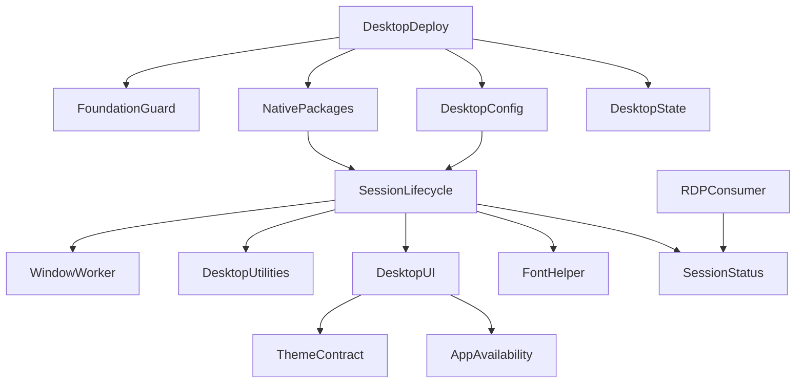

# Technical Design: Native Hyprland Desktop Backport

## Overview

Backport the current source desktop to Ubuntu26.04's Hyprland0.53.3+ds-4 and
ABI-matched hyprbars0.53.0-1. Decorations are implemented first: preserve the
owner's mac/win311 titlebars, hostcolor/oil borders and window actions. The source
Lua syntax is translated into native conf fragments and legacy IPC commands;
stateful callbacks/timers become one session-scoped Python worker.

### Goals

Retain every source desktop capability and original bar/menu/helper behavior;
provide a separate full native-GPU session while keeping KDE dormant and SDDM
unchanged; preserve the T2 installation and protected boot/storage boundary.

### Non-Goals

Newer compositor/source builds, plugin rebuilds, GPU-policy reproduction, RDP
units, terminal/theme ownership, global keyboard changes, KDE removal or Plasma
runtime. Battery/Bluetooth widgets remain separately scoped candidate additions.

## Boundary Commitments

### This Spec Owns

- Guarded native desktop package requests and packaged compositor/plugin check.
- Source-derived desktop conf, decorations/hostcolor, layouts/geometry/snapping,
  keyboard/mouse bindings, physical monitors and session input configuration.
- Complete source Waybar, appmenu/Fuzzel/Mako, GTK initial settings/Xfe seed,
  clipboard/night helpers and selected-session services/lifecycle/status.
- Desktop-specific deployment, managed-state receipts, scoped restoration and
  static/session integration checks.

### Out of Boundary

Foundation owns shared package/preflight protections and root deploy integration.
Apps owns application binaries/availability; fonts owns installed fonts and
/usr/local/bin/hypr-xfonts. Themes owns terminal/palette files, scoped Terminator GTK tab CSS/import and
hypr-term/hypr-termtheme. Desktop never replaces user gtk.css. RDP owns remote units, monitor/input/cursor/audio transitions.
No shared root deploy edits, snitchd, login defaults/authentication/autologin,
KDE changes, protected system mutations, boot rollback or global ld/library edits.

### Allowed Dependencies

Existing uv/pyinfra foundation, Python3 standard library for typed IPC/state,
native Hyprland/hyprbars/uwsm, Waybar, Mako, Fuzzel, Hyprlock, portals, Xwayland,
wl-clipboard/cliphist, jq, python3-gi/GTK3/layer-shell and Adwaita assets. Existing
PipeWire/WirePlumber/wpctl/pipewire-pulse remain authoritative. Desktop uses
application/font/theme consumer contracts; no application installers run on click.
Rootless-containers is not required by this native backport.

### Revalidation Triggers

Package versions/origin/ABI token, plugin path/properties, conf/dispatcher/JSON/
event generation, state schema, session status or terminal contract changes.
Recheck font consumers for changed registration semantics; RDP for changed
session status/protocols. Changed apt metadata/hooks requires new guarded plan.

## Architecture

### Existing Architecture Analysis

Local feature implementation is absent. Source writes Lua and assorted home
files directly, assumes VM/RDP inputs/outputs and enables watchers broadly.
Native0.53 can express decorations and source window operations, but cannot
execute Lua callbacks. A single selected-session worker replaces those callbacks;
no compatibility interpreter or compositor patch is introduced.

### Architecture Pattern & Boundary Map

Dependency direction: provenance/package/state types → IPC/config/helper
components → session orchestration → desktop UI → explicit consumer contracts.
Provisioning imports those building blocks but never imports RDP/theme installers.

### Technology Stack

| Layer | Choice | Role |
| --- | --- | --- |
| Compositor/plugin | Ubuntu0.53.3+ds-4 /0.53.0-1 | Native ABI-matched pair |
| Configuration | Hyprland0.53 conf | Static settings, binds and plugin options |
| IPC/state | Python3.12+ standard library | Bounded validated JSON, sockets, atomic state |
| Session | uwsm0.25.2+ds-1/systemd user | Explicit independent session lifecycle |
| UI | Waybar0.15, GTK3/layer-shell, Mako1.10, Fuzzel1.12 | Source widgets/menu/notifications |
| Clipboard | cliphist0.5, wl-clipboard2.2 | Runtime history and X11 bridge |
| Provisioning | Locked pyinfra3.10.0 | Foundation-guarded optional feature operations |

Versions describe current native candidates, not permission to bypass fresh
resolution, scripts/trigger review or protected-component checks.

## File Structure Plan

All paths are future implementation files. Source .lua files are evidence;
installed compositor configuration contains no Lua execution.

| Path | Component/responsibility |
| --- | --- |
| `config/desktop/source-manifest.json` | NativePackages: pinned source dispositions and native ABI baseline |
| `manage/desktop_packages.py` | NativePackages: package/ABI/plugin file ownership validation |
| `tasks/desktop.py`, `deploy_desktop.py` | DesktopDeploy: optional pyinfra orchestration/entry point |
| `manage/desktop_state.py` | DesktopState: owned-path receipts/backups and restore conflicts |
| `tools/desktop_hostcolor.py` | DesktopConfig: source hostcolor generation |
| `templates/hyprland/hyprland.conf.j2` | DesktopConfig: main owned fragment include order |
| `templates/hyprland/{monitors,input,looknfeel,bindings,layouts,decorations,autostart}.conf.j2` | DesktopConfig: one source-derived responsibility per fragment |
| `files/desktop/hypr_ipc.py` | HyprIPC: typed selected-instance JSON/dispatch transport |
| `files/desktop/hypr-window-worker.py` | WindowWorker: socket/timer loop, geometry memory, reserved areas and snapping |
| `files/desktop/window_geometry.py` | WindowWorker: pure validated geometry/state transforms |
| `files/desktop/window_snap.py` | WindowWorker: source edge/corner/move detection calculations |
| `files/bin/{hypr-deco,hypr-layout,hypr-shadow,hypr-glass,hypr-pin,hypr-kbd,hypr-nightmode,hypr-launch,hypr-desktop-context}` | DesktopControls: bounded CLI commands/legacy IPC translation |
| `files/hypr/hyprlock.conf` | DesktopControls: explicit local lock visuals |
| `files/hypr/shaders/{night-green,night-dark}.glsl` | DesktopControls: pinned source shaders |
| `files/bin/hypr-session` | SessionLifecycle/SessionStatus: start/reload/stop/status and environment checks |
| `files/systemd/user/t2-hyprland.target` | SessionLifecycle: selected-session service boundary |
| `files/systemd/user/t2-hypr-{windows,waybar,mako,cliphist,clip-bridge}.service` | SessionLifecycle: one service/process responsibility each |
| `files/systemd/user/t2-hypr-cliphist-wipe.{service,timer}` | DesktopUtilities: scoped01:00 wipe schedule |
| `templates/sessions/t2-hyprland.desktop.j2` | SessionLifecycle: additive selectable SDDM session entry |
| `templates/waybar/config.jsonc.j2`, `files/waybar/style.css`, `files/waybar/power.png` | DesktopUI: complete original bar and artwork |
| `files/bin/{hypr-appmenu,hypr-sparkline,hypr-agent-quota}` | DesktopUI: source menu and collectors |
| `files/bin/{hypr-cliphist,hypr-clip-bridge}` | DesktopUtilities: private clipboard behavior |
| `files/{fuzzel/fuzzel.ini,mako/config,xfe/xferc}` | DesktopUI: source visuals and Xfe initial seed |
| `templates/gtk-3.0/settings.ini.j2` | DesktopUI: GTK initial rendering/settings |
| `tests/test_desktop_packages.py`, `tests/test_desktop_state.py` | NativePackages/DesktopState fixtures |
| `tests/test_hypr_config.py`, `tests/test_hypr_controls.py` | Config/control translation fixtures |
| `tests/test_hypr_windows.py`, `tests/test_hypr_ipc.py` | IPC/geometry/snapping/reconnect fixtures |
| `tests/test_desktop_utilities.py`, `tests/test_desktop_ui.py` | Clipboard/collector/menu/module fixtures |
| `tests/integration/test_desktop_session.py` | Explicit cross-component/session validation |

Installed conf lives under `~/.config/t2-mac-kde/hyprland/`, leaving existing
~/.config/hypr untouched. Private helper modules live under
~/.local/lib/t2-mac-kde/desktop; command names above under ~/.local/bin. Source
helper lookups are adapted to this owned config root. Existing unowned CLI
conflicts are reported, never overwritten silently. Seed user files only when
absent or explicitly adopted with backup. No root deploy file changes.

## Components and Interfaces

| Component | Intent | Requirements | Dependencies | Contract |
| --- | --- | --- | --- | --- |
| NativePackages/DesktopDeploy | Guarded optional native provisioning |1.1,1.2,1.3,1.4,1.5,2.1,2.2 | Foundation P0 outbound | Batch/state |
| DesktopState | Repeatability and scoped recovery |7.5,7.6 | Owned paths P0 external | State |
| DesktopConfig/DesktopControls | Conf/decorations/actions/input |4.4,4.5,4.6,4.7,6.5,7.1,7.2 | HyprIPC/native plugin P0 outbound | CLI/state |
| HyprIPC/WindowWorker | Source layouts/geometry/snapping |4.1,4.2,4.3 | Native0.53 JSON/socket P0 external | Service/event/state |
| SessionLifecycle/SessionStatus | Session isolation and consumer discovery |2.3,2.4,2.5,2.6,3.1,3.2,3.3,3.4,3.5,3.6,7.4 | uwsm/font helper P0 outbound | CLI/state |
| DesktopUI | Complete bar/menu/source visuals |5.1,5.2,5.3,5.4,5.5,5.6,5.7,5.8,7.3 | App/theme contracts P1 outbound | UI/JSON |
| DesktopUtilities | Clipboard/notification/shader lifecycle |6.1,6.2,6.3,6.4 | wl-clipboard/cliphist P0 external | CLI/service |
| Session integration tests | Evidence including host preservation |7.7 | Real target host P0 external | Validation |

### NativePackages, DesktopDeploy and DesktopState

Use foundation PackageRequest/validate_request/inspect_plan/install_packages
contracts; the feature does not extend source='ubuntu' or bypass protected hooks.
Required native package set: hyprland, hyprland-plugin-hyprbars, uwsm, waybar,
mako-notifier, fuzzel, hyprlock, xdg-desktop-portal-hyprland, portal-gtk,
xwayland, wl-clipboard, cliphist, python3-gi, GTK3/layer-shell introspection,
Adwaita icon/cursor assets and jq. Observe shared existing audio/font/application
packages; do not reinstall or claim ownership. Source hyprland-guiutils is an
excluded unused convenience package, not silently replaced with a source build.

Require compositor Provides and plugin Depends to share hyprland-abi-6d24081
for the reviewed baseline. Discover the single package-owned loadable hyprbars
.so with dpkg file facts and reject ambiguity, foreign ownership or wrong ABI.
Render its absolute escaped path in the plugin fragment. Recheck installed
versions and actual `hyprctl plugin list` before native session acceptance.

Preview performs no writes/downloads/reloads. Apply records per-component
changed/unchanged/failed/pending, preserves original files before explicit
adoption and never restarts SDDM/KDE. Receipts under
~/.local/state/t2-mac-kde/desktop contain owned path, previous existence, backup,
old/new digest and operation result, without environment or credential dumps.
Restore only matching owned digests; preserve user-edited conflicts and shared
packages. Root-owned additive session entry has a separate receipt; no boot or
package rollback is attempted. Refuse protected transaction effects before apply.

### DesktopConfig and DesktopControls: exact backport matrix

The primary0.53.3 implementation sources establish the following operations.
All helper arguments are validated; address selectors must match `0x[0-9a-fA-F]+`.
`hyprctl` calls are argv arrays with explicit selected instance; untrusted strings
are never interpolated into shell or batch command text.

| New source form/behavior | Native0.53 form/adaptation |
| --- | --- |
| hl.config/require modules | owned `source = absolute.conf` fragments and nested native blocks |
| hl.plugin.load + add_button | `plugin = package-owned.so`; `plugin { hyprbars { hyprbars-button = bg,size,icon,command,fg } }` |
| Lua gradient colors/angle | `col.active_border = rgb(...) rgb(...) ... 45deg`; inactive rgb151515 |
| window.close | `dispatch killactive`; explicit close uses closewindow address selector |
| fullscreen maximized/fullscreen | `dispatch fullscreen 1` / `fullscreen 0`; source toggles preserved |
| window.move special:minimized follow=false | `dispatch movetoworkspacesilent special:minimized`; restore taskbar/`togglespecialworkspace minimized` |
| float enable/disable/toggle | `dispatch setfloating address:...` / `settiled address:...` / `togglefloating` |
| pin | ensure floating via setfloating then `dispatch pin address:...`; preserve cross-workspace pin behavior |
| set_prop no_blur/opacity | `dispatch setprop address:... no_blur 0/1`; `setprop address:... opacity 0.82/1` |
| window.move/resize x,y | `movewindowpixel exact X Y,address:...`; `resizewindowpixel exact W H,address:...` |
| center/focus/cycle/raise | active-only centerwindow; addressed centering uses calculated exact pixel move; movefocus l/r/u/d, cyclenext, bringactivetotop |
| drag/resize mouse | bindm SUPER,mouse:272,movewindow; bindm SUPER,mouse:273,resizewindow |
| relative size key actions | resizeactive signed X Y |
| hl.define_submap | native submap=super, mirrored one-action bindings followed by submap reset; Escape/catchall reset |
| hl.timer / hl.on window/monitor/reload | WindowWorker timer + socket2 notifications + authoritative snapshots |
| hl.get_windows/monitors/cursor | clients/monitors/cursorpos JSON; arrays/IDs normalized by HyprIPC |
| hl.config screen_shader | `hyprctl keyword decoration:screen_shader <owned path or empty>` |
| hl.dsp.exec_cmd | conf `exec` for fixed trusted binds; hypr-launch uses argv-preserving `uwsm app --` |
| hl.env | selected-session environment/`env =` only; omit VM LP_NUM_THREADS/software overrides |

Decorations.conf renders source mac: height24, pale host tint, navy text,
JetBrainsMono Nerd Font11, left alignment, padding10, close/maximize/glass/pin
buttons with original colors/sizes. Win311: height22, host color, white centered
Sans Bold11, right alignment, padding4/button padding2 and original
close/minimize/pin/glass glyph buttons. Preserve source insertion order and
bar_precedence_over_border=true. The original hostcolor utility generates
hostname-derived color/pale values and oil-gradient active border; hostname is
used locally and need not be committed. Double-click maximizes. Button command
values contain only trusted fixed helper paths/native commands.

`hypr-deco mac|win311`, `hypr-layout dynamic|golden-h|golden-v|golden-spiral|next`,
`hypr-shadow on|off`, `hypr-kbd de|us|toggle`, `hypr-nightmode
next|off|green|dark|apply|status` preserve source CLI semantics. Choices reside
in owned desktop state/config-mode files; render fragments atomically and reload
once only after successful render. Invalid input exits2 without state mutation;
IPC/parse failures exit1 and preserve previous effective choice. No-arg query
forms retain source output. Window toggles snapshot one explicit address and
never act on a changed focus between commands. Persistent desktop state is
separate from disposable per-instance flags. On reload reapply keyboard/nightmode
and per-window effects without recursively generating another reload.

Input fragment copies the exact source de,us/mac_nodeadkeys, and option string
from research. Preserve Option/Command/Super mapping. Physical monitor default
is preferred/auto and actual available output scale; user display preferences
can override an owned fragment after explicit adoption. Never disable laptop
outputs or devices from RDP flags; no source VM cache or cursorzone module.

### HyprIPC and WindowWorker

HyprIPC functions: `query(kind: Literal['clients','monitors','cursorpos',
'activewindow']) -> validated snapshot`, `dispatch(name: AllowedDispatcher,
argument: str) -> Result`, `keyword(name: AllowedKeyword,value: str) -> Result`.
Failure Result contains category absent-session/timeout/bad-json/unsupported/
window-gone and a redacted diagnostic. Calls timeout within1s. Invalid values
are rejected before dispatch; bounded retry only on reconnect. Batch only trusted
numeric geometry commands, maximum32 per batch; check each reply.

Normalized Window has address, class_name, monitor_id, position/size integer
pairs, floating, mapped, hidden, pinned, fullscreen and workspace. Monitor has
id/name, physical width/height, scale, transform, x/y and reserved tuple; convert
to logical geometry before calculations. Validate dimensions/finite scale and
re-query after topology changes. Source JSON at/size arrays must not be treated
as Lua .x/.y or monitor objects. No full title/application content in logs.

The worker has one nonblocking instance lock and selected-instance socket2
subscription. Window/monitor/config events mark state dirty; query snapshots
instead of trusting incomplete event payloads. One1s snapshot maintains source
geometry and reserved-area correction; during floating-window movement active
window/cursor checks run at most every100ms, settle after three stable ticks,
then stop high-frequency geometry work when idle. Monitor inventory refreshes on topology/reload and the1s geometry snapshot to
detect mode/scale changes without socket events; cache it between those queries.
One full clients query per second maximum.
No unbounded polling fork loop or blocking callbacks inside the compositor.

Dynamic mode floats/centers new windows, remembers class-relative fractions,
cascades duplicate-class windows32px and keeps titlebars below the reserved bar.
Persist changes atomically at5s/close/clean stop, exclude X3270 self-sized windows,
and reject malformed/nonfinite/out-of-range state. On mode changes clear previous
dynamic float rules, select master-left/top with mfact0.618 or dwindle with
split1.236/preserve_split/force_split2, then address-target live mapped windows
to float/tile. Restore bounded remembered geometry when returning dynamic.

Aerosnap retains source2px edges/80px corners, three-tick settle, original size
for drag-away restoration, half/quarter/top-max geometry. Use current style's
actual22/24px bar height plus border/reserved extents, fixing source's fixed24px
assumption. Monitor resize keeps relative floating geometry usable; negative
origins/scale/rotation and disconnected monitors have explicit fixture cases.
Re-query target identity before mutation; disappeared windows are harmless
skips. Reconnect resets ephemeral address snapshots, retains class memory and
resynchronizes without duplicate watchers. Native magnetic snapping retains
source general.snap10/12px behavior, independently of Aero snapping.

Desktop right-click binds to hypr-desktop-context, which queries cursor/monitor/
visible clients, rejects window/titlebar/reserved-area hits and invokes
hypr-appmenu --at X Y only for empty desktop space. Source menu GTK keyboard
navigation and desktop-entry launch semantics remain unchanged.

### SessionLifecycle and SessionStatus

Add `/usr/share/wayland-sessions/t2-hyprland.desktop` without changing existing
SDDM configuration/defaults. Entry uses the owned session wrapper, which runs
`uwsm start -- /usr/bin/Hyprland --config <owned absolute main.conf>` and exports
only selected-session XDG desktop markers. No autologin or Plasma process.
Native conf runs `hypr-session start` once after compositor startup; it checks
instance ownership/Wayland readiness, invokes `uwsm finalize` with compositor
variables, then starts t2-hyprland.target. Target is PartOf graphical-session.target
and starts owned services; services are not enabled globally for every KDE login.
A second concurrent graphical session under the same user's systemd manager
is refused clearly because activation environment is shared; do not overwrite
another session's environment. Same target-user session selection is explicit.

Font registration runs through the fonts helper on initial and replacement
Xwayland DISPLAY readiness; helper's bounded exit semantics are preserved.
No inferred Fixedsys success on optional-directory skip. No VM initial lock;
explicit lock invokes Hyprlock with owned source-derived config. Power menu
uses existing systemd/logind permissions; logout uses uwsm stop. Clipboard,
worker, bar, Mako and wipe timer stop with the target; no daemon lingers in KDE.
Portals select Hyprland screencast/screenshot and GTK file chooser for this
session only; preserve KDE portal config. Startup failure stops owned target
and reports nonzero; it does not restart login manager or change defaults.

`hypr-session status --json [--instance SIGNATURE]` returns schema_version1,
uid, instance_signature, compositor_executable, compositor_version,
plugin_abi, wayland_display, x_display nullable, runtime_dir, bus_address and
state preparing/ready/stopping. Instance defaults only from current explicit
HYPRLAND_INSTANCE_SIGNATURE; absent/ambiguous/wrong-user selection exits2 and
returns unavailable with reason, never newest-directory selection. Validate
owner/socket/liveness before reporting ready. Status is read-only; no full
environment dump. Optional ephemeral status file is private0600 below the
instance's XDG_RUNTIME_DIR/t2-mac-kde; stale state never establishes liveness.
RDP consumes status but owns all remote transitions.

### DesktopUI and DesktopUtilities

Full bar coverage is enumerated in source-inventory.md; retain every module and
both graph/numeric branches. Audio uses existing pipewire-pulse with wpctl mute,
0–100 slider and5% scroll steps. No plasma-pa. Source refresh signals8–13 remain
module-compatible, sent only to the selected session's owned Waybar MainPID.
All application launches use `hypr-launch COMMAND ARG...` → argv-preserving
`uwsm app -- COMMAND ARG...`; templates remove redundant uwsm wrappers. Thus
application scopes survive bar service reload. Desktop-entry IDs/actions go
through uwsm, not string expansion. Recheck actual app executables/availability;
blocked Vivaldi or terminal availability is visible, no browser substitution.

Appmenu retains categories/recents/Run/power, keyboard focus and dismissal,
source artwork/fallback application icons and per-monitor placement. External
Win31 icons remain optional as in source; no required private/licensed download.
Fuzzel launch-prefix uses uwsm and `terminal=hypr-term -x` consumes the validated
theme launch argument contract. Terminal-theme module reads the fixed ~/.local/state/terminator-profile and
invokes next/prev. Allowed profiles cycle default→navy→fixedsys→cream→petrol;
default maps to cobalt assets. Missing state means default; unknown/multiline
state is an error/unavailable display, never silently defaulted. Theme CLI
publishes state last; desktop never writes palettes/state. Empty theme CLI input
means next; apply does not cycle or trigger live Terminator/bar/notification
actions. Invalid arguments exit2 unchanged; invalid state/runtime failure exit1. Missing theme CLI is unavailable
until that independent feature is present, not an installer side effect.

Quota retains source provider/cache distinction, bounded network/app-server
queries and stale markers. Read only existing user authorization when selected;
missing credentials/CLI is unknown, never0% or100%. Bound network10s and child
process15s, cache0600, no tokens or response bodies in logs. Sparkline data stays
read-only /proc+/sys and bounded source sample intervals.

Cliphist history is private under the selected runtime, limit200, sensitive and
Bitwarden-focus exclusion, picker/status/manual wipe and01:00 timer. Timer is
session scoped; delayed activation after01:00 runs the due wipe once, without
starting watchers in KDE. No tmpfs mounts/fstab edits. Runtime files are0700/
0600; logout removes owned history only. Bridge converts only STRING-only
Latin-1 to UTF-8, skipping existing text/plain/UTF8_STRING/TEXT and preventing
self-trigger loops. Preserve Unicode, image selection, cancellation and empty
selection behavior. Mako is the sole notification daemon of this session;
conflicting same-user notification ownership fails visibly before replacement.
Shaders remain source GLSL300es; validate compile/load and three-state feedback.

## Requirements Traceability

| Requirement | Summary | Components | Interfaces | Flows |
| --- | --- | --- | --- | --- |
|1.1,1.2,1.3,1.4,1.5 | Native source-led compatible delivery | NativePackages/DesktopDeploy | manifest/guard/ABI | preview/apply |
|2.1,2.2 | Strict protected host boundary | NativePackages/DesktopState | guarded plan/receipts | refuse/restore |
|2.3,2.4,2.5,2.6 | T2/audio/KDE/GPU preservation | SessionLifecycle | selected target/status | startup/validation |
|3.1,3.2,3.3,3.4,3.5,3.6 | Full independent session | SessionLifecycle/DesktopControls | uwsm/status/font helper | start/reload/stop |
|4.1,4.2,4.3 | Layout/geometry/snapping | WindowWorker/HyprIPC | JSON/socket2/native dispatch | mode/drag/topology |
|4.4,4.5,4.6,4.7 | Original decorations/actions/bindings | DesktopConfig/DesktopControls | conf/legacy IPC | style/control/reload |
|5.1,5.2,5.3,5.4,5.5,5.6,5.7,5.8 | Complete source UI | DesktopUI | modules/menu/collectors/app report | render/launch/status |
|6.1,6.2,6.3,6.4 | Clipboard and notifications | DesktopUtilities/SessionLifecycle | runtime/services/timer | watch/pick/wipe/exit |
|6.5 | Night filters | DesktopControls | keyword/shaders | choose/reload |
|7.1,7.2 | Source keyboard and physical devices | DesktopConfig/DesktopControls | input/monitor conf | select/switch |
|7.3,7.4 | Adjacent feature seams | DesktopUI/SessionStatus | consumer contracts/status | theme/RDP query |
|7.5,7.6,7.7 | Repeat/recover/evidence | DesktopState/DesktopDeploy/session tests | receipts/results | repeat/restore/validate |

## Error Handling

Package ABI or protected-plan failure blocks package/session publication and
leaves defaults unchanged. Config render/parse failure retains last valid
fragments. Missing app/theme capability produces an unavailable UI state; core
compositor/plugin/worker startup failure prevents ready status. IPC timeouts,
stale window identities and socket loss are bounded/recoverable; repeated failure
reports degraded status without retry storms. Never mask a failure with `|| true`
and claim successful acceptance. Restore conflict leaves edited files intact.

## Testing Strategy

-1.1–1.5,2.1–2.2: fixture native ABI/origin mismatches, Snap transitions,
  protected removals/scripts/triggers and unknown hook effects; preview spies
  prohibit downloads/writes/services. Re-resolve packages before real apply.
-4.4–4.7: parse generated conf on native0.53; compare mac/win311 scalar fields,
  gradient order and button actions with source inventory; repeat reload three
  times and verify no duplicate buttons. Live close/max/minimize/restore,
  pin/glass/shadow toggles and one-shot Super cancellation.
-4.1–4.3: deterministic snapshots for class memory/cascade/X3270 exclusion,
  all four mode transitions, negative origins, fractional scale/rotation,
  reserved bars, style-height change, monitor removal and all snap zones;
  event reconnect/window-disappearance/idle-query bounds.
-3.1–3.6,7.1–7.4: selected native session startup, font-helper bounded calls,
  portals, no Plasma, bar reload preserving app PIDs, explicit lock/logout,
  session-status wrong-user/stale/missing selection, no services leaking to KDE.
  Physical German Mac Option+L=@ and source Super/Command/Option keys, US/DE
  switch/reload, external display and pointer/trackpad checks.
-5.1–5.8: manifest-to-bar module coverage both branches; appmenu keyboard/
  dismissal/recents/desktop-entry arguments including spaces and shell syntax;
  unavailable Vivaldi/theme/quota, source power artwork and GTK/Xfe seed
  preservation. Real audio slider/mute/scroll operates existing native routes.
-6.1–6.5: sensitive/password-manager exclusion,200-entry eviction, picker
  cancellation, runtime permissions,01:00/delayed wipe/logout; Latin-1 legacy
  NEdit to native app, UTF-8/image nonconversion, bridge loop prevention;
  notifications and source shader compile/cycle/reapply.
-2.3–2.6,7.5–7.7: repeated apply/restore/conflict fixtures and before/after
  protected-path hashes/package dependencies. On real host record speakers/mic
  capture/routes, camera, touch bar, keyboard/trackpad, Wi-Fi/Bluetooth and
  suspend/resume. Mark unavailable live checks pending; GPU reproduction/
  transition results require captured custom unit and remain separate.

## Migration Strategy

Preview/inventory first; guard native packages and back up explicitly adopted
files. Render owned config and validate0.53 syntax, then original decorations,
controls, worker and complete UI/services. Publish only additive session entry;
owner selects it at unchanged SDDM. Native live acceptance precedes any readiness
claim. Restoration stops only owned target, restores matching owned paths and
removes owned session entry; shared packages/KDE/audio/protected state remain.
