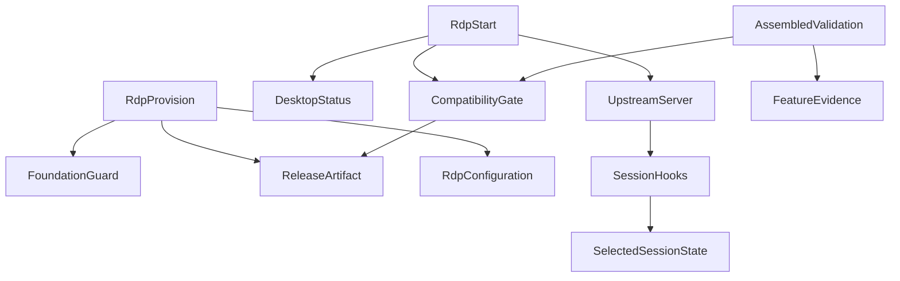

# Technical Design: Upstream RDP on Native Hyprland

## Overview
Port P21–P22 using the unmodified MuNeNiCK/hypr-rdp release archive and supported configuration/hooks. Own the P23 assembled validation checklist only. The compositor remains Ubuntu0.53.3+ds-4 with its packaged hyprbars ABI pair. Upstream v0.1.8 documents0.54+; compatibility with the chosen desktop is **pending**, not asserted by this design.

### Goals
Authenticated selected-session RDP, recoverable local laptop behavior, reviewable artifact/runtime gates and honest assembled acceptance.

### Non-Goals
Fork packages/patches, any compositor or RDP build, local display/input suppression, lock bypass, source away policy, PAM/system-auth changes or GPU-policy reconstruction.

## Boundary Commitments
### This Spec Owns
Release selection/verification, RDP configuration/private secrets and receipts, RDP-only units/start wrapper/hooks, remote capability checks and final assembled validation consumer.

### Out of Boundary
Desktop owns compositor/config/decorations, physical monitors, topology/removal window-placement recovery, local keyboard baseline and `hypr-session`; themes owns terminal/theme commands/state. Containers owns rootless runtime. Foundation owns shared package/execution protection. No shared root deploy edits, KDE/SDDM changes, audio-stack replacement or protected storage/kernel/boot/initramfs mutations.

### Allowed Dependencies
Foundation reviewed PackageRequest/transaction guard and uv/pyinfra; Python standard library, systemd user manager, desktop status schema1 and selected-instance IPC; existing PipeWire/WirePlumber/T2 UCM, Wayland/XKB/PAM/libva libraries required by actual ELF inspection. PAM library linkage does not authorize PAM configuration. Optional fusermount3/FUSE interface is usable only if already available or its userspace package passes foundation protection; no modprobe/module rebuild.

### Revalidation Triggers
Archive digest/version/build, ELF dependency closure, compositor or protocol generation, desktop status schema/lifecycle, upstream hook semantics, client codec/capture/audio/input/file-transfer settings or package hook metadata changes invalidate the corresponding evidence.

## Architecture
### Existing Architecture Analysis
No local RDP implementation exists. Source `tasks/hypr_rdp.py` selects a patched package/build, broad graphical-session units and journal watchers; helpers assume Virtual-1/QEMU devices, Lua IPC, redirect audio and unlock-on-connect. These assumptions are rejected. Adopt upstream hooks and maintain only bounded laptop-specific reconciliation.

### Technology Stack
| Layer | Choice | Role |
| --- | --- | --- |
| Server | upstream v0.1.8 x86_64 tar.gz candidate | Unmodified maintainer executable |
| Runtime | native Hyprland0.53.3 / systemd user | Explicit selected session, pending compatibility |
| Helpers | Python3 standard library | Validation, private atomic state and bounded IPC |
| Provisioning | foundation pyinfra/uv | Reviewed optional entry point and guarded dependencies |
| Audio/input | existing PipeWire/WirePlumber/XKB | Preserve T2 local behavior |

## File Structure Plan
All paths below are planned new files; no source build or patches directory is created.

| Path | Component and responsibility |
| --- | --- |
| `config/rdp/upstream-release.json` | ReleaseArtifact: immutable URL/tag/size/digest and source provenance |
| `manage/rdp_artifact.py` | ReleaseArtifact: safe archive and actual ELF/ABI verification |
| `manage/rdp_state.py` | RdpProvision: owned-path receipt/backup/conflict restoration |
| `tasks/rdp.py`, `deploy_rdp.py` | RdpProvision: optional feature entry and foundation-protected requests |
| `templates/rdp/config.toml.j2` | RdpConfiguration: explicit upstream options, no plaintext password |
| `files/bin/hypr-rdp-control` | RdpStart: validate/start/stop/status/diagnose CLI |
| `files/rdp/session.py` | RdpStart: desktop identity selection and scoped environment |
| `files/rdp/capabilities.py` | CompatibilityGate: schema1 capability evidence and invalidation |
| `files/bin/hypr-rdp-session` | SessionHooks: fixed start/end helper with bounded idempotent cleanup |
| `files/systemd/user/t2-hypr-rdp.service` | RdpStart: selected-session-only unit |
| `tools/validate_assembled_port.py` | AssembledValidation: P23 checklist consumer and missing-evidence report |
| `tests/test_rdp_artifact.py`, `tests/test_rdp_state.py` | Artifact/receipt fixtures |
| `tests/test_rdp_config.py`, `tests/test_rdp_session.py` | Config/identity/hooks/lifecycle fixtures |
| `tests/integration/test_rdp_native.py` | CompatibilityGate: opt-in native/client protocol validation |
| `tests/test_assembled_port.py` | AssembledValidation: evidence aggregation fixtures |

Install server under `/usr/local/lib/t2-mac-kde/hypr-rdp/v0.1.8/`, using its absolute path rather than overwriting another `hypr-rdp` command. Helpers/modules live under `~/.local/bin` and `~/.local/lib/t2-mac-kde/rdp`; config under `~/.config/t2-mac-kde/rdp`; receipts under `~/.local/state/t2-mac-kde/rdp`. Private runtime state is per selected signature beneath `$XDG_RUNTIME_DIR/t2-mac-kde/rdp`. Preserve unowned conflicts.

## Components and Interfaces
| Component | Requirements | Dependencies and contracts |
| --- | --- | --- |
| ReleaseArtifact |1.1,1.2,1.3 | Outbound maintainer archive P0; verification batch/state |
| RdpConfiguration |2.1,2.2,2.3,4.2,4.3,4.4,4.5 | External upstream config P0; validated config/state |
| RdpStart |3.1,3.3,3.4,5.3 | Outbound desktop status P0/systemd P0; CLI/service |
| CompatibilityGate |1.2,4.1,4.2,4.3,4.4,4.5,6.2,6.3 | External native server/client P0; scoped evidence/state |
| SessionHooks |3.2,3.3,4.1,4.2 | External upstream hooks P0/desktop IPC P0; events/state |
| RdpProvision |5.1,5.2,5.3 | Outbound foundation guard P0; batch/receipt |
| AssembledValidation |6.1,6.2,6.3 | Inbound feature evidence P0; checklist/report |

### ReleaseArtifact
Pinned candidate: `https://github.com/MuNeNiCK/hypr-rdp/releases/download/v0.1.8/hypr-rdp-v0.1.8-x86_64-linux.tar.gz`, size8936327, SHA256 `f8b324fcf5c169dd4df269685294db55078b4d6a28cd47a6a86e00d35671b0fd`. Metadata comes from earlier release API research; no artifact has been downloaded or executed here.

`verify(archive, manifest, host_facts) -> VerificationResult(status, checks, reasons)` requires exact digest/size, architecture, safe relative member names/no traversal or escaping links, expected executable inventory and isolated extraction. Inspect interpreter, NEEDED and symbol-version requirements with readelf/objdump before any execution; resolve against target libraries and reject unresolved/incompatible closure. Never run ldd on an unverified artifact. Record executable digest/version and target dependency facts. Native dependencies pass foundation inspect_plan/install protections, including maintainer scripts/triggers; unknown protected effects block provisioning. No cargo/rust/build toolchain is needed.

### RdpConfiguration
Validate explicit `bind`, `auth_mode="configured"`, nonempty username and private owner-only `password_file`; reject empty credentials, unsafe ownership/mode, conflicting inline password and undocumented option values. TLS choice is explicit certificate/key paths or explicitly accepted upstream generated identity with fingerprint verification before non-loopback acceptance. Keep secrets out of argv/log/report/receipts. Operator chooses bind/exposure; no firewall/router mutation or guessed LAN intent. Prepared config/unit stays disabled by default.

Set `keyboard_layout_policy="compositor"`; consume desktop baseline de,us/mac_nodeadkeys plus `compose:caps,shift:both_capslock_cancel,altwin:swap_ralt_rwin,lv3:lalt_switch`. Set `audio_mode="mirror"` or `"off"`, never redirect. Baseline capture/codec are selected from upstream supported values only, initially `wlr`/`avc420`/`auto` pending actual native protocol/encoding tests. `ext`/ClearCodec are alternatives only after their own gate, not proof derived from fork configuration. No compositor software-rendering environment variables. File transfer defaults off until direction-specific FUSE/client tests pass; text/image clipboard independently tested. No source `planar` assumption.

### RdpStart and CompatibilityGate
`hypr-rdp-control validate|start|stop|status|diagnose --instance SIGNATURE` returns0 on success,2 for invalid/missing selection/configuration,1 for failed/pending capability with structured reason. `start` uses `hypr-session status --json --instance SIGNATURE`, schema1: uid, instance_signature, compositor_executable/version, plugin_abi, wayland_display, nullable x_display, runtime_dir, bus_address, state. Require matching user, ready state, socket ownership and liveness; never select newest runtime directory. Pass only validated selected-session environment to a private per-run wrapper; never import arbitrary environment into the global user manager.

Unit binds to `t2-hyprland.target` with PartOf/After/Requisite and its start wrapper rechecks selected identity. It has no graphical-session WantedBy and no automatic enablement during provisioning; explicit control starts the unit only for one chosen session. No Plasma dependency. Selected target stop terminates server/hooks and reconciliation; failed preconditions never run server. Use bounded on-failure restart, each attempt revalidating identity/configuration/evidence. Active config changes report reconnect-required; explicit restart only.

Capability evidence schema1 records artifact/executable digest, target library facts, desktop identity/version/ABI/protocols, config-mode digest excluding secrets, client identity/version, each check's passed/failed/pending status and evidence reference. Missing/mismatched evidence is pending. Never hardcode a runtime success from version comparison or monitor fallback tests. README0.54+ remains a documented unsupported-by-declaration discrepancy even if empirical0.53 tests pass; record exact tested configuration and limits.

A deliberate `diagnose` mode may run an authenticated **loopback-only** bounded server in the selected session to establish native evidence; normal listener activation remains blocked until required checks pass. It requires valid auth/TLS and explicit diagnostic invocation, permits no wider exposure and always stops/reconciles afterward. A loopback-capable client is required; otherwise pending. Inspect actual registry/protocol capabilities and test capture/input/headless output/mode changes/codec initialization, then authenticated connect, resize, replacement/reconnect and cleanup. Upstream legacy monitor fallback is only one source-level path and does not satisfy this gate. A failed native test records an exact blocker; no alternate version/build is selected automatically.

### SessionHooks
Upstream `on_session_start`/`on_session_end` use fixed trusted absolute helper commands only, shell-quoted at render time without interpolated client input. Upstream waits at most10 seconds for preceding hooks but does not kill timed-out children: helper enforces shorter deadlines and process-group cleanup, serializes selected-session state and rejects stale run tokens. State is private schema1 with server run token, selected signature, observed remote output IDs and cleanup status; no credentials/full environments.

Hooks observe remote output lifecycle and reconcile only port-owned state; never disable physical outputs/input, send lock-unlock signals, replace local audio defaults or copy source virtual cursor binaries. Leave cursor behavior to the verified upstream capability; do not hide physical cursor globally. Desktop's WindowWorker owns topology/removal window-placement recovery. RDP does not move/resize windows or consume private worker state; no desktop placement-snapshot API is assumed. For remote-output removal diagnostics/assertions, use bounded read-only native0.53 IPC `clients`/`monitors` observations in the already validated selected instance, before and after removal with a finite settling deadline. Validate fresh geometry/output identity and report observed recovery or a failure; missing session/desktop worker, invalid/unavailable observations or lost identity leave recovery acceptance pending with a reason. Observations do not authorize a second placement policy, recovery dispatcher or polling daemon. Cleanup on duplicate/out-of-order disconnect, replacement, server stop/crash and compositor stop must be idempotent. Never act on stale/foreign session. Preserve lock state and physical monitor/input/audio snapshots; if local route recovery is needed restore only an RDP-owned change that still matches its receipt, avoiding reversal of a user change.

### RdpProvision and AssembledValidation
`preview` performs read-only plan validation, without download/service start; `apply` verifies prerequisites before owned-file installation, records changed/unchanged/failed/pending and leaves listener disabled. Back up explicitly adopted files with old/new digests. Restore only owned paths matching installed digests; report edited conflicts. No package removal/rollback, root-auth changes, journal-group membership or away service. Foundation request/transaction guards reject Snap/Flatpak and protected hooks, autoremove and T2-support changes. No shared root entry point edits.

P23 consumes producer-owned checks through explicit supplied evidence paths; it does not invent a shared producer schema. Normalize supplied evidence into `{feature, check, status, evidence_ref, prerequisite, reason}` with status passed/failed/pending and preserve producer provenance/time/version. Missing/stale/unrecognized evidence is pending. Checklist includes original decoration/layout/widget/terminal/theme behavior, keyboard, fonts/apps/tools, containers, resource preservation, native GPU rendering, physical/external monitors, RDP capture/input/clipboard/audio, lock/reconnect, T2 audio/mic/camera/touchbar/network/suspend and protected-state hashes. Missing existing GPU unit blocks GPU reproduction/transition and attach/detach acceptance; it does not block unrelated static work. No collection of private machine identifiers, credentials or boot secrets.

## Error Handling and Security
Unverified artifact/dependency/config/session returns a reason and no normal listener. Runtime failure stops only selected RDP activity and reports pending recovery evidence; logs contain check IDs and redacted diagnostics. Hook timeout cannot authorize new local changes. Valid authentication never grants unlock of an existing local lock. Inspect TLS identity/auth rejection and configured connection replacement using an actual client before exposure acceptance.

## Testing Strategy
- Artifact fixtures: corrupt digest, unsafe member/link, wrong architecture, missing interpreter/symbols, protected/unknown dependency hooks and unchanged-host preview (1.1–1.3,5.1).
- Configuration/session fixtures: absent credentials/TLS/exposure, secret redaction, stale/wrong-user/multiple sessions, KDE inactivity and no disruptive config restart (2.1–2.3,3.1,3.4,5.3).
- Lifecycle fixtures: duplicate/reordered hooks, timeout/stale token, failure/restart/target stop, physical-output/input/lock invariants, bounded read-only removal observations with desktop-owned window recovery, missing/invalid observation pending cases and edited receipt conflicts (3.2,3.3,4.1,4.2,5.2).
- Opt-in native/client tests: actual ELF closure, selected capture protocol/encoding/headless output/resize, valid/invalid authentication, reconnect/replacement, clipboard/file directions and FUSE absence, Option+L and source Super, mirror/off preservation and lock behavior (1.2,2.2,4.1–4.5). Report host-only observations separately.
- Aggregation fixtures: missing/stale producer evidence and missing GPU unit cannot become passed; final checklist preserves provenance and validation class (6.1–6.3).

## Requirements Traceability
| Criteria | Components |
| --- | --- |
|1.1,1.2,1.3 | ReleaseArtifact, CompatibilityGate |
|2.1,2.2,2.3 | RdpConfiguration, RdpStart |
|3.1,3.2,3.3,3.4 | RdpStart, SessionHooks |
|4.1,4.2,4.3,4.4,4.5 | RdpConfiguration, SessionHooks, CompatibilityGate |
|5.1,5.2,5.3 | RdpProvision, RdpStart |
|6.1,6.2,6.3 | AssembledValidation, CompatibilityGate |
