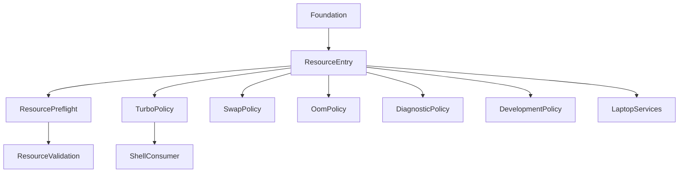
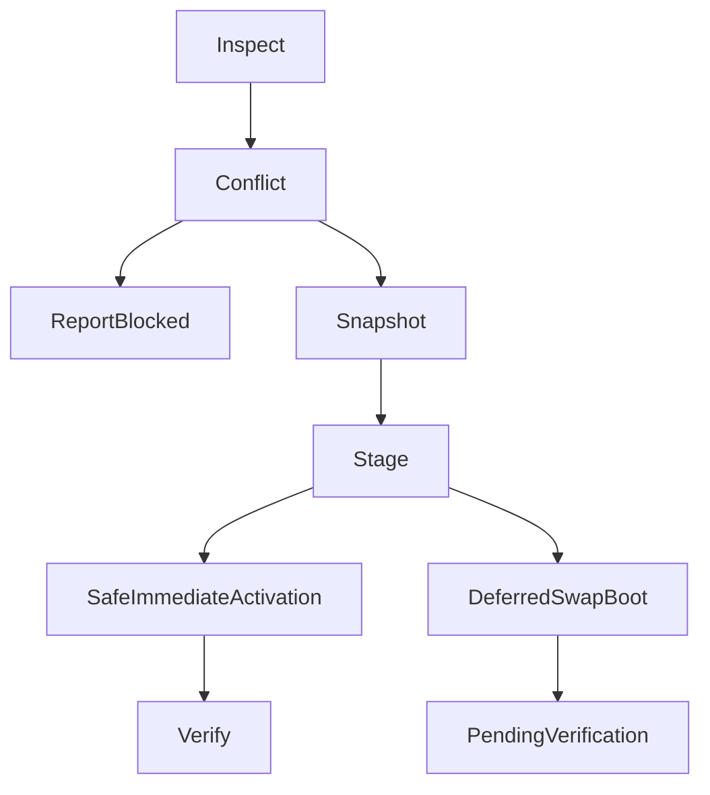

# Design Document

## Overview
Provide an optional pyinfra feature for the owner's physical Ubuntu KDE T2 Mac covering P01–P06. It ports native resource controls from pinned upstream while retaining existing disk swap, login, hardware and mount policy. Reusable upstream settings are adapted individually; configuration presence is reported separately from effective activation.

### Goals
- Deliver boot turbo control, safe staged compressed swap, desktop-aware earlyoom, bounded diagnostics and Avahi suppression.
- Make every adopted setting observable and reversible with captured prior state.
- Supply a stable turbo fragment for shell-user-tools without editing its startup files.

### Non-Goals
Starting Plasma inside Hyprland, GPU policy, T2 kernel/GRUB changes, SSH policy, module blacklisting, QEMU agent, snitchd/firewall, autologin, KDE removal, new printer/hibernation setup, Snap and Flatpak are excluded.

## Boundary Commitments

### This Spec Owns
- Optional resource entry point, preflight/state capture, resource-only restore and validation commands.
- `/etc/tmpfiles.d/no-turbo.conf` and `~/.config/t2-mac-kde/turbo.bash` contents.
- Distinct zram, earlyoom, journald, conditional coredump and development-limit artifacts listed below.
- Avahi activation prevention, including installed systemd and D-Bus paths; preservation assertions for laptop services.

### Out of Boundary
- Shell startup loading belongs to shell-user-tools. Resource policy never rewrites `.bashrc`, `.profile` or foundation's nvm block.
- Root `deploy.py`, bootstrap, shared package policy and unrelated foundation configuration belong to foundation/integration.
- GPU service capture is adjacent and does not block independent resource work; this feature never changes GPU state.

### Allowed Dependencies
Use existing uv environment/Python >=3.11 and pyinfra3.10.0; consume foundation's reviewed permitted-package execution. Native Ubuntu `systemd-zram-generator`, `earlyoom`, existing systemd and coreutils are used. Package installation must pass foundation apt simulation/no Snap/Flatpak checks. Foundation task approval/execution remains an upstream readiness constraint, not a claim that it is implemented.

### Revalidation Triggers
Fragment path/alias semantics require shell-user-tools revalidation. Swap priority/size, OOM selection, service masks, package resolution, kernel, systemd or session-process-name changes require resource runtime revalidation. Desktop stack changes require the Hyprland desktop and KDE preservation checks; GPU configuration remains untouched.

## Architecture

### Existing Architecture Analysis
Current root deploy includes `tasks/node.py` and `tasks/tools.py`; there is no resource implementation. `pyproject.toml` pins pyinfra3.10.0. Core product/tech/structure steering files are absent; roadmap and package policy are authoritative available steering. Foundation exposes execution intent but its shared approved package contract must be available before privileged feature application.

### Architecture Pattern & Boundary Map
Adopt native drop-ins and small pyinfra modules. Dependency direction: immutable policy values and typed observations → component operations → optional entry point. Components cannot import downstream shell/desktop code or mutate each other's files.



Arrows denote execution/contract consumption, not permission for reverse imports. ResourcePreflight is required before all mutation. No custom resident daemon or abstraction framework is introduced.

### Technology Stack
| Layer | Choice/version | Role |
|---|---|---|
| Provisioning | Python >=3.11, pyinfra3.10.0 in uv | Explicit privileged operations and dry-run |
| System policy | systemd259.9 observed | tmpfiles, drop-ins, service masks |
| Swap | Ubuntu generator1.2.1-2 candidate | Native zram management, boot activation |
| OOM | Ubuntu earlyoom1.9.0-1 candidate | Polling and process selection |
| User shell | Existing Bash and sudo | Exact user aliases, no added privilege rules |

Package candidates are observations, not immutable installation pins or proof of compatibility. Implementation validates installed help/man syntax and resolved dependencies before application.

## File Structure Plan
All below are **new** paths; no existing repository files are modified by this feature. Later shared integration may include this entry point separately.

| Repository path | Component / responsibility |
|---|---|
| `deploy_resources.py` | ResourceEntry: optional include order and read-only/report/restore mode selection |
| `tasks/resource_policy/preflight.py` | ResourcePreflight: typed host facts, conflicts, snapshots, backup manifest and guarded native package execution |
| `tasks/resource_policy/turbo.py` | TurboPolicy: tmpfiles and user fragment |
| `tasks/resource_policy/swap.py` | SwapPolicy: generator package/drop-in and staged activation |
| `tasks/resource_policy/oom.py` | OomPolicy: earlyoom package, reviewed arguments and service |
| `tasks/resource_policy/diagnostics.py` | DiagnosticPolicy: journal and applicable crash retention |
| `tasks/resource_policy/development.py` | DevelopmentPolicy: only justified development limit operations |
| `tasks/resource_policy/services.py` | LaptopServices: Avahi masks and capability preservation |
| `tasks/resource_policy/validate.py` | ResourceValidation: effective-state and restoration checks |
| `files/resource-policy/no-turbo.conf` | Exact requested tmpfiles rule |
| `files/resource-policy/turbo.bash` | Exact alias fragment |
| `files/resource-policy/zram.conf` | Capped zram policy |
| `files/resource-policy/earlyoom` | Source-adapted earlyoom arguments |
| `files/resource-policy/journald.conf`, `coredump.conf` | Source-compatible bounded storage drop-ins |
| `tests/resource_policy/test_preflight.py` | Preflight/conflict/snapshot fixtures |
| `tests/resource_policy/test_turbo.py`, `test_swap.py`, `test_oom.py` | Component behavior and failure fixtures |
| `tests/resource_policy/test_diagnostics.py`, `test_development.py`, `test_services.py` | Effective-policy and preservation fixtures |
| `tests/resource_policy/test_integration.py` | Optional-entry dry-run, repeat-run and restoration contracts |

Managed targets: `/etc/systemd/zram-generator.conf.d/60-t2-resource.conf`, `/etc/default/earlyoom`, `/etc/systemd/journald.conf.d/60-t2-resource.conf`, `/etc/systemd/coredump.conf.d/60-t2-resource.conf` when applicable, `/etc/sysctl.d/60-t2-resource-limits.conf`, turbo targets above and installed Avahi activation masks/overrides. The earlyoom environment file is a single conventional package-owned config destination; capture and preserve unrelated comments/options or stop on conflicting local policy. No base systemd, sysctl, fstab or shell files are replaced.

State targets: root-owned `/var/lib/t2-mac-kde/resource-policy/` stores baseline manifests/file backups (0700 directory,0600 metadata/backups); user fragment backup is referenced with original uid/gid/mode. Do not capture secrets or whole unrelated configs. These runtime state paths are planned, not created by spec work.

## System Flows

Conflict outcomes are component-specific. A failed mandatory preflight prevents that component's mutation; validation never converts unknown status to success.

## Requirements Traceability
| Requirement | Summary | Components | Interfaces | Flows |
|---|---|---|---|---|
| 1.1, 1.2, 1.3, 1.4 | Exact turbo behavior and shell preservation | TurboPolicy | Fragment, tmpfiles state | Boot/runtime |
| 2.1, 2.2, 2.3, 2.4 | Safe supplemental compressed swap | SwapPolicy | Generator drop-in, snapshot | Stage then boot |
| 3.1, 3.2, 3.3, 3.4 | Desktop-aware pressure policy | OomPolicy | earlyoom args/service | Inspect then enable |
| 4.1, 4.2, 4.3 | Applicable diagnostic limits | DiagnosticPolicy | Native drop-ins | Merge then verify |
| 5.1, 5.2, 5.3 | Individual tuning dispositions | DevelopmentPolicy | Tuning matrix/sysctl | Inspect then apply |
| 6.1, 6.2, 6.3, 6.4 | Avahi prevention, laptop preservation | LaptopServices | Installed activation paths | Snapshot then mask |
| 7.1, 7.2, 7.3, 7.4 | Review, restoration, package rules | ResourceEntry, ResourcePreflight, ResourceValidation | Plan/status/restore | All |

## Components and Interfaces

| Component | Intent | Requirements | Key dependencies | Contracts |
|---|---|---|---|---|
| ResourceEntry | Optional execution and integration | 7.1, 7.2, 7.3, 7.4 | Inbound foundation P0; outbound all components P0 | Batch |
| ResourcePreflight | Facts, conflict gates, backups | 7.1, 7.3 | External host files/systemd P0 | State |
| TurboPolicy | Boot default and exact aliases | 1.1, 1.2, 1.3, 1.4 | External intel_pstate P0; inbound shell consumer P1 | State |
| SwapPolicy | Supplemental compressed tier | 2.1, 2.2, 2.3, 2.4 | External generator/kernel P0 | State |
| OomPolicy | Pressure thresholds/process avoidance | 3.1, 3.2, 3.3, 3.4 | External earlyoom/process comm P0 | State |
| DiagnosticPolicy | Journal/crash retention | 4.1, 4.2, 4.3 | External systemd/handler P0 | State |
| DevelopmentPolicy | Adopted development limit floor | 5.1, 5.2, 5.3 | External sysctl P0 | State |
| LaptopServices | Avahi activation and preservation | 6.1, 6.2, 6.3, 6.4 | External systemd/D-Bus P0 | State |
| ResourceValidation | Effective results and restoration | 7.2, 7.3 | Inbound all component targets P0 | Batch |

### ResourceEntry and ResourcePreflight
**Batch contract:** operator-selected optional `deploy_resources.py` runs in the foundation-supported uv/pyinfra context, with explicit modes `plan`, `apply`, `status`, `restore`. No importing for read-only status may invoke privileged operations. `plan` renders configuration/operations; `apply` requires valid snapshots before writes. `status` does not modify the host. `restore` uses the first unmanaged baseline and records completion per resource; reruns do not overwrite that baseline with managed state.

**Typed contract:** Python type hints/dataclasses define `HostFacts` (OS, memory KiB, swap list, resume evidence, packages, systemd reachability, sysctl values, process comm names, activation paths), `ComponentStatus` (`component: str`, `state: Literal['planned','active','staged','blocked','inapplicable','failed','restored']`, `checks: list[CheckResult]`), and `CheckResult` (`name: str`, `expected: str`, `observed: str | None`, `ok: bool | None`, `reason: str | None`). Validate path/size/priority inputs, reject unknown modes; subprocess arguments are separated from shell interpolation. No shared global deploy edits.

**Preconditions:** native Ubuntu supported environment, package-policy path available, sufficient privilege for mutation, readable baseline for affected targets and service bus where required. Missing privileged resume metadata is an unknown preservation check: do not change resume paths, and require accessible read-only inspection before asserting complete preservation. Inspect competing zram providers, generator configs and existing files; never overwrite unmanaged collisions silently. Foundation task 2.4 must provide the public contract `install_packages(request: PackageRequest, *, prevent_service_start: bool = False) -> None` before affected resource package setup. Call `install_packages(request, prevent_service_start=True)` to suppress automatic daemon start until its config/conflict gate is satisfied. Foundation owns the temporary deny-all policy-rc.d transaction: preserve an existing known deny policy unchanged, reject unrecognized/conflicting policy before mutation, and restore owned temporary state on failure with journal recovery. Resource code does not implement or replace this guard; unavailable support blocks affected daemon setup. Protected maintainer-hook checks and the no-go plan gate remain independent: service-start suppression never authorizes boot, crypto or other protected-system changes.

**State contract:** store absent/present file state, content hash, original ownership/mode, symlink target, effective sysctl values, unit enable/active/mask states and activation override paths. Do not alter preexisting unrelated overrides. Restore stops only services newly activated by this feature, restores exact prior files/masks/values, then verifies. Package additions are reported and retained on restore to avoid removing dependencies used elsewhere. A local edit after apply causes restore conflict, not blind overwrite.

### TurboPolicy
Manage exactly `/etc/tmpfiles.d/no-turbo.conf`:
```text
w /sys/devices/system/cpu/intel_pstate/no_turbo - - - - 1
```
Apply only this file using `systemd-tmpfiles --create /etc/tmpfiles.d/no-turbo.conf`; validate `no_turbo=1`. Check interface and duplicate/conflicting tmpfiles paths before changing. Missing interface yields blocked status; never replace the CPU driver or chmod sysfs.

The 0644, user-owned `~/.config/t2-mac-kde/turbo.bash` contains exactly:
```bash
alias turbo-on='echo 0 | sudo tee /sys/devices/system/cpu/intel_pstate/no_turbo'
alias turbo-off='echo 1 | sudo tee /sys/devices/system/cpu/intel_pstate/no_turbo'
alias turbo-status='cat /sys/devices/system/cpu/intel_pstate/no_turbo'
```
The shell consumer sources this readable fragment in its distinct startup block. No PATH changes, nvm code, automatic turbo toggle on source or passwordless sudo policy. Aliases retain normal sudo/tee/cat diagnostics; deployment verifies readback independently. Runtime aliases do not edit the persisted boot default. Restore original turbo file/fragment and prior live sysfs value after validating availability.

### SwapPolicy
Use package `systemd-zram-generator` and an additive `[zram0]` drop-in:
- `zram-size = min(ram / 2, 4096)` (MiB expression; caps this ~63 GiB host at4 GiB).
- `compression-algorithm = lz4` after installed kernel/module capability check; no silent algorithm fallback.
- `swap-priority = 100` only if all preserved disk swaps have lower priority; otherwise block and report.

The size adopts the upstream generator's capped default instead of the source's ~31 GiB logical device. It does not preallocate4 GiB physical RAM; no compression ratio or performance benefit is promised. Reject existing alternate managers/devices, occupied zram0, kernel arguments suppressing generator or conflicting higher-precedence settings unless already provably identical managed state. Inspect `swapon --show --bytes`, generator configuration and `/sys/block/zram*/comp_algorithm` or supported module capabilities.

Never run swapoff, mkswap on existing devices, live restart of systemd-zram-setup or edit fstab/resume/initramfs. Stage config and mark pending boot activation; daemon-reload is allowed but starting/restarting swap setup is excluded from routine apply. After a normal separately scheduled boot, validation checks zram size/algorithm/priority and retained disk swap. If an existing managed device needs resize, keep staged until boot. Restoration likewise stages device removal for boot while restoring prior config; do not free active swap under pressure. Hibernation must continue to target disk; no image to zram and no claimed16 GiB capacity sufficiency.

### OomPolicy
Install earlyoom only after inspecting systemd-oomd/other earlyoom/nohang policy and selected service/cgroup coverage. Existing enabled/active competing userspace killers conservatively block enabling a second killer; report their identities without disabling them. Kernel OOM remains available. Check installed earlyoom supports `--dryrun`, selected flags and its service EnvironmentFile; do not assume upstream master equals installed syntax.

Preserve source `-m 5 -s 10 -r 3600`. Memory and **aggregate disk+zram free swap** thresholds must both be met. Five percent is a modest final headroom on64 GiB, not a response-time guarantee; source claims about zram-only swap are rejected. KILL defaults to half thresholds (2.5%/5%) per installed manual; report this explicitly. Normal controlled acceptance uses dryrun; destructive real-pressure runs are isolated from the owner's session.

Extend source `--avoid` to anchored, actual first15-byte comm names for `init`, `systemd`, `sshd`, `Hyprland`, `hyprland`, `waybar`, `mako`, `hypr-rdp`, `pipewire`, `wireplumber`, `uwsm`, `agetty`, `plasmashell`, `kwin_wayland`, `kwin_x11`, `ksmserver`, `startplasma-wayl`, `startplasma-x11`, `sddm`, `sddm-helper`, `kded6` and observed KDE session services. Build the final regex from escaped literal comm names and inspect processes in both sessions. `--avoid` is a score bias, not immunity from earlyoom or kernel OOM; never document “never kill”. Do not use process-group killing. Reject source prefer entries for chromium/chrome/firefox/firefox-esr/electron as a group: no laptop workload evidence supports forcing browser/electron data loss over other apps. A future preference requires reviewed policy change.

Capture original `/etc/default/earlyoom`, install reviewed args, enable/start only after configuration and dryrun validation; restart only when content changes. Existing nonidentical local earlyoom arguments require reconciliation, not blind replacement. Restore prior args and service state.

### DiagnosticPolicy
Reuse source journal `[Journal] SystemMaxUse=500M; RuntimeMaxUse=100M` in a separate drop-in. Preserve storage mode, other namespaces, existing rate limits and stricter conflicting caps; report a higher-precedence conflict rather than silently claiming limits. Restart journald only on changed applicable config and verify merged state with installed `systemd-analyze cat-config` plus service/journal checks. No destructive vacuum operation.

Check refreshed `kernel.core_pattern`, installed crash handler and config precedence. Current observation invokes systemd-coredump259.9, making `[Coredump] MaxUse=500M; KeepFree=1G` applicable. If Apport/other handler becomes active, omit/remove only our previously managed drop-in and mark inapplicable; never change core_pattern/install a replacement handler. Limits describe retained systemd core storage and free-space policy, not peak crash processing usage. Use installed service reload semantics if needed, not newer systemd-coredumpd assumptions. Restore only our drop-ins; expired diagnostics cannot be recreated by rollback.

### DevelopmentPolicy: complete source tuning decisions
Disposition `reject` means add no managed override and leave the existing host value unchanged, even if it coincidentally equals source. `adopt floor` means use `max(existing_effective, target)` after identifying conflicting persistent sources; never lower a larger value. Each adopted runtime sysctl has its prior value captured and only that key applied, avoiding a broad `sysctl --system` replay.

| Source setting/value | Disposition and laptop rationale | Effective check / restoration |
|---|---|---|
| vm.swappiness100 (asset150 replaced by host data) | Reject: mixed disk/zram costs unmeasured; retain60 | sysctl; no write |
| vm.vfs_cache_pressure50 | Reject: cache trade-off unmeasured; retain100 | sysctl; no write |
| vm.page-cluster0 | Reject: disk remains; retain3 | sysctl; no write |
| vm.watermark_boost_factor0 | Reject: no fragmentation/stall measurements; retain15000 | sysctl; no write |
| vm.watermark_scale_factor125 | Reject: avoid reserving~1.25% without measured need; retain10 | sysctl; no write |
| vm.dirty_background_bytes67108864 | Reject: no laptop I/O evidence; preserve ratio/byte combination | sysctl; no write |
| vm.dirty_bytes268435456 | Reject: same; no new fixed dirty cap | sysctl; no write |
| vm.dirty_writeback_centisecs1500 | Reject: preserve500 and writeback behavior | sysctl; no write |
| fs.inotify.max_user_watches524288 | Reject override: existing559994 already exceeds source | sysctl; no write |
| fs.inotify.max_user_instances1024 | Adopt floor1024: permits concurrent IDE/watch-tool instances beyond observed128 | sysctl and changed-key apply; restore saved value/drop-in |
| nofile soft65536, hard524288 in system/user/PAM | Reject global override: current4096:524288, broad soft increase can affect select-based tools; workload requirement unproven | process/systemd/PAM limits; no write |
| kernel.watchdog0 | Reject: physical laptop diagnostics remain enabled1 | sysctl; no write |
| default_qdisc=fq | Reject: no network workload/capability evidence | sysctl/tc where readable; no write |
| tcp_congestion_control=bbr, tcp_bbr boot load | Reject: no congestion benchmark/kernel evidence | sysctl/modules; no write |
| tcp_fastopen3 | Reject: application/network compatibility untested | sysctl; no write |
| rmem_max,wmem_max134217728 | Reject:128 MiB caps unmotivated | sysctl; no write |
| tcp_rmem4096 87380 134217728 | Reject: receive window/buffer profile unmeasured | sysctl; no write |
| tcp_wmem4096 65536 134217728 | Reject: send profile unmeasured | sysctl; no write |
| netdev_max_backlog5000 | Reject: no packet-drop evidence | sysctl; no write |
| netdev_budget600 | Reject: no softirq budget evidence | sysctl; no write |
| tcp_no_metrics_save1 | Reject: preserve path metrics reuse | sysctl; no write |
| tcp_mtu_probing1 (both source files) | Reject: no demonstrated PMTU blackhole | sysctl; no write |
| /tmp tmpfs1G, nr_inodes1m and mount options | Reject override: source1G can constrain developer builds; preserve actual mount and existing cap/options | findmnt/fstab/unit config; no write/remount |
| root noatime,commit=60 | Reject both changes: preserve relatime/durability and fstab | findmnt/fstab; no write/remount |
| mitigations=off,audit=0,haltpoll arguments | Excluded: VM security/polling policy inappropriate | compare /proc/cmdline and boot config; no write |
| serial getty/console, root password SSH, module blacklist/unload/initramfs | Excluded: preserve hardware/security and T2 boot | baseline hash/state comparison; no write |

The tuning report retains these decisions, observed values and reasons; there is no hidden optional network/performance profile. An unavailable rejected-setting read is reported unknown and cannot justify mutation. Adopted-key unavailability or conflicting persistent override blocks that key.

### LaptopServices
Source disabled list is **not** used as an operation list. Preserve the installed apple-t2-audio-config ALSA UCM files under `/usr/share/alsa/ucm2/AppleT2` and related `conf.d/AppleT2x2`, `AppleT2x4`, `AppleT2x6`, PipeWire/pipewire-pulse/pipewire-alsa, WirePlumber and Bluetooth audio support. No audio package/config/service removals or VM audio rerouting are included. Desktop-audio steering supersedes any implication that protecting KDE processes requires running Plasma in Hyprland; these are avoidance entries for whichever sessions are actually used. Preserve `bluetooth.service`, existing power manager (power-profiles-daemon/TLP as found), CUPS service/socket/path capability and ModemManager. No force-enable changes to services intentionally inactive before apply. Validate available Bluetooth controller and CUPS packages/configurability; unknown service state is a blocked check, not absence.

For installed Avahi, discover canonical service/socket, `dbus-org.freedesktop.Avahi.service` aliases and `/usr/share/dbus-1/system-services/org.freedesktop.Avahi.service` activation metadata. Stop and mask the canonical systemd service/socket plus distinct installed aliases as necessary; resolve every installed D-Bus entry's `SystemdService` and `Exec` routes. If systemd routing fully prevents activation, retain package files unchanged. Fresh inspection found the installed D-Bus entry routes to `dbus-org.freedesktop.Avahi.service` with `Exec=/bin/false`, and the alias links to the canonical service. Therefore canonical service/socket masking prevents these observed paths; capture the alias symlink and verify its effective masked status. Any newly discovered executable fallback or unresolved route blocks this component and requires design revalidation; do not invent a D-Bus override or edit vendor files. Runtime acceptance explicitly attempts installed socket/D-Bus activation and confirms daemon remains stopped. Missing Avahi is compliant absent status, without installing it.

Do not remove CUPS or alter printer destinations, Avahi-dependent printer discovery, unrelated resolver/mDNS modules, network service policy or firewall. Report lost mDNS/DNS-SD discovery and direct IP/hostname printing option. Restore only masks/overrides this feature created and prior service enabled/running states.

### ResourceValidation
Read-only status aggregates component results with independent persisted/effective checks. Unsupported/bus-denied checks remain unknown. Restore mode shares baseline manifests but does not invoke apply implicitly. Critical mismatch stops successful overall reporting; independent components may retain successful results while the overall feature is pending/blocked.

## Data Models
`SnapshotManifest` records schema version1, target host identity, run id, component id, managed path, original file state/hash/uid/gid/mode or symlink, applied hash, runtime old value, original service states and activation overrides. Original state is immutable once first mutation succeeds. Validate manifest ownership and paths; refuse cross-host or unexpected-path restore. No application database, event transport or remote API is introduced.

## Error Handling
Absent interface/algorithm/package or competing OOM/swap manager → affected component blocked, no conflicting writes. Apt policy failure → no install. Bus denied → runtime checks unavailable and mutation blocked. Higher-precedence conflicting config → report exact path/value. Failed service/config validation → restore that component's changed files/state when safe, retaining failure evidence. Active swap restoration remains staged until boot. Existing custom edits after apply require conflict resolution. No broad exception suppression or `|| true` around required checks.

## Testing Strategy
- **Fixture checks:** source/owner turbo exact content, alias sudo failure, absent sysfs and duplicate tmpfiles detection (1.1–1.4); swap collision/high-priority disk/unsupported lz4 and no swapoff/restart/fstab operation (2.1–2.4); earlyoom dynamic thresholds,15-byte comm and browser preference rejection/competing manager (3.1–3.4).
- **Native config checks:** render journal and handler-conditional coredump fixtures including Apport and stricter later overrides (4.1–4.3); assert each tuning disposition and higher-limit preservation, no boot/SSH/module/root-mount operations (5.1–5.3).
- **Activation/preservation checks:** systemd and unexpected executable D-Bus fallback fixtures, preexisting masks, missing Avahi, bus denied, CUPS/Bluetooth/power unchanged, no QEMU/snitchd/firewall operations (6.1–6.4).
- **Integration:** foundation package simulation rejects Snap/Flatpak/transitional dependencies; safe package no-autostart; optional entry dry-run; unchanged rerun without restarts; partial failure/edited-file/cross-host restore rejection; staged swap status distinguished from active (7.1–7.4).
- **Physical-host acceptance, planned:** capture accessible full baseline, apply reviewed plan; source fragment and run aliases with normal sudo, verify nvm remains available through consumer integration; after scheduled boot inspect zram/disk swap and no_turbo; use earlyoom dryrun with synthetic process observations rather than exhaust owner's session; verify effective journal/core config; test Avahi activation denial and preserved Bluetooth/CUPS/power. Full real-pressure tests require an isolated environment. Preserve boot/resume/GPU files by hashes and check ordinary suspend/resume if available without claiming new hibernation support.

## Migration Strategy
Stage additive configuration and preserve original state; use safe immediate activation only for components with validated native reload/start paths. Swap always waits for boot. Independent shell loading and root deploy inclusion are consumer/integration work. Restore captured component state without live swap teardown; verify again after boot. Retention-caused historical diagnostic deletion is irreversible and reported. No runtime deployment, reboot, pressure test or restoration has been performed during this specification phase.

## Subsequent protected-system clarification

Read .kiro/steering/protected-system-boundary.md and t2-hardware-policy.md.
The owner's strict no-go prohibits direct and indirect cryptsetup/LUKS/LVM,
fstab/swap/resume, kernel/module/header, bootloader and initramfs/mkinitcpio
changes/regeneration. All feature dependency operations must pass that foundation
plan gate; unknown maintainer-script/trigger effects block the affected plan.
No autoremove, boot rebuild, protected-file rollback or hardware-driver changes.
Preserve the fresh T2 hardware stack and dormant installed KDE. Read-only
baseline and live hardware acceptance are separate; no runtime success is claimed.
