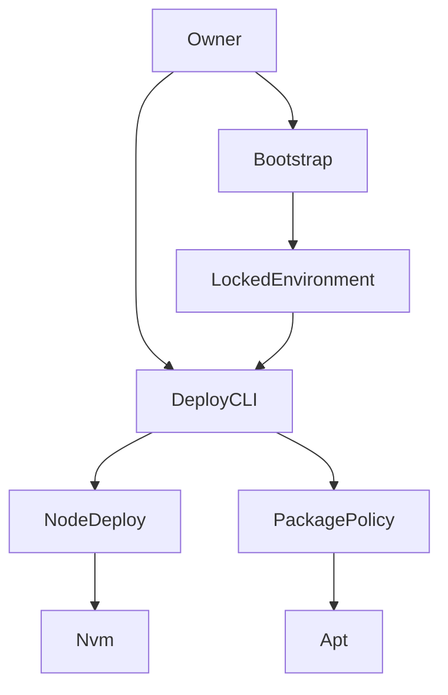

# Technical Design: Local System Foundation

## Overview

Extend the existing local pyinfra scripts with a consistent execution contract
and package-policy enforcement. The owner runs commands as their desktop user;
uv maintains `.venv`, nvm maintains Node/npm, and sudo is limited to system
operations. Reuse these established tools rather than build a provisioning engine.

### Goals

Reproduce the locked environment, provide repeatable Node provisioning, preview
changes, and enforce the prohibition on Snap/snapd and Flatpak in every managed
installation path. Preserve the working laptop configuration.

### Non-Goals

GPU switching, turbo/memory tuning, container runtime configuration, desktop
widgets/themes, and RDP. The existing CLI package list remains usable but its
application-specific configuration belongs to subsequent port specifications.

## Boundary Commitments

### This Spec Owns

- Bootstrap and command execution, privilege boundaries, and result reporting.
- Per-user Node selection and managed Bash initialization.
- Package-policy pins, package-plan checks, and the installation contract used
  by every repository deploy that installs system packages.

### Out of Boundary

No login/session changes, GPU power transitions, T2 boot changes, desktop
removal, or agent-specific workflow package selection. No automatic removal of
existing prohibited runtimes: detect and report them before package deployment;
remediation must be planned explicitly to avoid deleting user applications/data.

### Allowed Dependencies

Python >=3.11, uv, pyinfra 3.10.0, Bash, curl, git, nvm, Ubuntu apt/dpkg, and
sudo. A working Python and curl are bootstrap prerequisites; report missing
prerequisites without trying a prohibited installer. Foundation imports no GPU,
desktop, or RDP modules. Package policy follows the steering rule.

### Revalidation Triggers

Changes to the package guard interface, permitted install sources, `.nvmrc`,
bootstrap/pyinfra versions, shell initialization, or sudo execution require
rechecking dependent deploys. Repository source changes or package upgrades
invalidate earlier package-plan acceptance.

## Architecture

### Existing Architecture Analysis

`bootstrap.sh` already uses `uv sync --locked`. `tasks/node.py` installs pinned
nvm and Node and edits a marked Bash block. `deploy.py` includes Node and CLI
operations; `tasks/tools.py` currently calls apt directly. There is no package
guard yet. Existing npm prefix overrides must be diagnosed before nvm mutation.

### Architecture Pattern & Boundary Map



Use small Python modules and native pyinfra operations. Dependency direction:
validated policy data → package guard → feature deploys → root orchestration.
Feature modules may import the guard; it must not import feature modules.
The shell launcher delegates provisioning and reporting to pyinfra.

### Technology Stack

| Layer | Choice / Version | Role | Notes |
| --- | --- | --- | --- |
| Environment | uv bootstrap pin 0.13.8, Python >=3.11 | Locked `.venv` | Existing uv is preserved; record version |
| Provisioning | pyinfra 3.10.0 | Facts, preview, operations | Existing lock retained |
| Node | nvm 0.41.0; Node 26.13.1 | User runtime | Node version read from `.nvmrc`; bundled npm/npx |
| System packages | Ubuntu apt/dpkg | Native packages and negative pins | No extra runtime dependency |

Pins describe the agreed baseline, not a request to upgrade working installs.

## File Structure Plan

### Modified Files

- `bootstrap.sh` — validate prerequisites, preserve pinned installation behavior,
  sync with `--locked`, and report failure with a nonzero exit.
- `tasks/node.py` — keep user-owned nvm provisioning, add prefix/conflict checks,
  verify the default alias target, type annotations, and additive shell setup.
- `tasks/tools.py` — route the existing package list through the shared guard.
- `deploy.py` — run local-user/platform preflight and package policy before
  including Node and CLI deploys.
- `README.md` — document preview/apply, locked execution, sudo authentication,
  conflicts, and the permitted-install contract.
- `.gitignore` — exclude generated reports and temporary downloads where needed.

### New Files

- `manage/preflight.py` — local desktop-user and Ubuntu compatibility checks.
- `manage/packages.py` — validate manifests and package simulations, expose the
  sole managed apt-install entry point.
- `manage/__init__.py` — module namespace only.
- `tasks/package_policy.py` — install negative apt pins and verify effective
  candidates, without altering existing user pin files.
- `files/apt/90-t2-package-policy.pref` — negative pins for `snapd` and `flatpak`.
- `tests/test_package_policy.py` — meaningful policy failure and resolution cases.
- `tests/test_node_configuration.py` — version/alias and prefix conflict cases.

These are planned paths, not claims of implemented files. pyproject.toml and
uv.lock change only if implementation discovers a required dependency; none is
currently proposed.

## System Flows

### Preview and Apply

Bootstrap separately creates `.venv`. Thereafter use `uv run --locked pyinfra`
for each deploy. `--dry` may run read-only facts and simulations but never
writes apt pins, installs packages, edits shell files, or changes services.

Preflight rejects root execution and unsupported targets before mutation.
Node-only deployment needs no sudo. The complete deploy installs/validates
package pins before any system package installation; use
`--use-sudo-password` for interactive authentication. No unattended password
storage. pyinfra errors remain failures; no catch-all success masking.

A dry run on an unpinned host simulates using a temporary policy overlay so it
can report the intended behavior without writing `/etc`. The apply run repeats
validation against effective policy immediately before installation. Missing
prohibited-package candidates caused by old apt indexes are not proof of a pin;
verify the configuration and all available versions as well.

## Requirements Traceability

| Requirement | Summary | Components | Interfaces | Flows |
| --- | --- | --- | --- | --- |
| 1.1, 1.2, 1.3 | Locked isolated environment | Bootstrap | bootstrap command | Bootstrap |
| 2.1 | Non-mutating preview | Preflight, PackageGuard, pyinfra | dry command | Preview |
| 2.2, 2.3, 2.4 | Privileges and failures | Preflight, deploy orchestration | local CLI | Apply |
| 2.5 | Repeatability | NodeDeploy, PackagePolicy, PackageGuard | operations/facts | Repeat apply |
| 3.1, 3.2 | Selected user toolchain | NodeDeploy | `.nvmrc`, nvm | Node apply |
| 3.3, 3.5 | Additive Bash setup | NodeDeploy | marked Bash block | New terminal |
| 3.4, 3.6 | Global packages and prefix | NodeDeploy | prefix preflight | Node apply |
| 4.1, 4.3 | Prohibited installations | PackageGuard | reviewed install manifest | Package apply |
| 4.2, 4.5 | Effective negative pins | PackagePolicy | apt preference file | Policy apply |
| 4.4 | Unavailable permitted path | PackageGuard | failure result | Resolution |
| 5.1, 5.2, 5.3 | Host preservation | Preflight, orchestration | scope allowlist | All applies |
| 5.6 | Strict protected-system no-go | Preflight, PackageGuard | protected plan gate | All applies |
| 5.5 | Preserve T2 hardware stack | Preflight, PackageGuard | protected baseline | All applies |
| 5.4 | Honest results | pyinfra, README | exit code/output | All commands |

## Components and Interfaces

| Component | Intent | Coverage | Key dependencies | Contract |
| --- | --- | --- | --- | --- |
| Bootstrap | Create locked environment | 1.1, 1.2, 1.3 | curl/uv P0 external | Batch |
| Preflight | Verify local execution | 2.1, 2.2, 2.3, 2.4, 5.1, 5.2, 5.3 | OS/user facts P0 external | Service |
| NodeDeploy | Select per-user Node | 2.5, 3.1, 3.2, 3.3, 3.4, 3.5, 3.6 | nvm P0 external | Batch, State |
| PackagePolicy | Maintain prohibitions | 2.5, 4.2, 4.5 | apt P0 external | Batch |
| PackageGuard | Validate/install allowed packages | 2.1, 2.4, 2.5, 4.1, 4.3, 4.4 | PackagePolicy P0 outbound | Service, Batch |
| Deploy orchestration | Order operations and expose results | 2.3, 2.4, 5.1, 5.2, 5.3, 5.4 | pyinfra P0 external | Batch |

### Bootstrap and Preflight

Bootstrap inputs: repository root and committed lock. Output: matching `.venv`
or nonzero failure. Downloads use HTTPS and pinned installer URLs; temporary
files are cleaned on exit. No global Python writes. Existing uv remains usable.

Preflight service contract: `validate_local_context() -> None` raises a clear
error for root, a non-local target, or unsupported OS. Foundation owns no
hardware writes. User home comes from the local desktop account, never a
remote host. README explicitly limits these scripts to `@local`.

### NodeDeploy

Inputs: exact validated version from `.nvmrc`, nvm pin, desktop home, inherited
environment and npm user config. Reject non-exact version input, incompatible
`prefix`/`globalconfig` overrides in `.npmrc`, or inherited prefix variables;
report the specific setting and leave it for explicit correction. Do not erase
user npm configuration or credentials. Do not adopt or uninstall system Node.

Use native nvm install, bundled npm/npx, and an exact default alias. Test the
alias's configured target, not merely `nvm version default`, which can resolve
through another moving alias. Source nvm inside each noninteractive Bash
operation. Keep `PROFILE=/dev/null` and manage one marked `.bashrc` block;
prepend `~/.local/bin` only if absent. No automatic per-directory switching is
introduced. New terminals use the default; `nvm use` selects `.nvmrc` explicitly.

Successful state requires matching nvm/Node versions, default alias, npm/npx
executables, and marked Bash block. A partial download never satisfies the
version predicate. Retry only the missing/incorrect step.

### PackagePolicy

Own `/etc/apt/preferences.d/90-t2-package-policy.pref`, with `Package: snapd flatpak`,
`Pin: version *`, and `Pin-Priority: -1`. Preserve `/etc/apt/preferences.d/nosnap.pref`
verbatim. Verify effective pinning and diagnose overriding administrator pins;
filenames alone are not accepted as precedence guarantees. Do not remove
existing apt sources or weaken other pins. If snapd or Flatpak is installed,
report the existing violation and stop package deployment with remediation
pending. Do not silently purge it or declare the host compliant.

### PackageGuard

Typed service surface:

```python
from dataclasses import dataclass
from typing import Literal

@dataclass(frozen=True)
class PackageRequest:
    packages: tuple[str, ...]
    source: Literal['ubuntu']

@dataclass(frozen=True)
class PackagePlan:
    installs: tuple[tuple[str, str], ...]  # package and resolved version
    removals: tuple[str, ...]

def validate_request(request: PackageRequest) -> None: ...
def inspect_plan(request: PackageRequest) -> PackagePlan: ...
def install_packages(
    request: PackageRequest, *, prevent_service_start: bool = False
) -> None: ...
```

Reject prohibited names (including architecture-qualified forms), arbitrary
apt options in package strings, and unreviewed sources. Run apt simulation in
a fixed locale with the same package arguments and no-recommends mode as apply.
Treat dependency-resolution failure, unrecognized simulation output, prohibited
resolved packages, or proposed removals as blocking errors. Recheck after any
index/policy change. Use native apt installation with negative pins and no
options that bypass policy. No generic arbitrary-command installer API.

The committed CLI review binds exact archive identities and the executable
host baseline. Read metadata in one bounded `apt-cache show` batch while
validating every record independently. A request already satisfied by those
exact reviewed versions schedules no package operation; observing that no-op
does not require admitting the post-install baseline for future changes.
Still reject pending dpkg state and changes during inspection. Any actual
installation requires the full reviewed baseline. The dpkg trigger lock's
contents are excluded because they are synchronization state; its file type
and mode remain bound. Explicit external executable symlinks bind both their
literal link target and a separately reviewed regular target file.

Service-start suppression is a separate opt-in contract for daemon packages.
`install_packages(request, prevent_service_start=True)` owns a bounded deny-start
transaction around the same guarded native installation. If `/usr/sbin/policy-rc.d`
is absent, stage an owned root-executable deny-all helper returning101, recording
prior absence and content identity before publication. If an existing policy is
a reviewed, known deny-all policy, leave it byte-for-byte unchanged and reuse it;
an unrecognized/conflicting policy blocks before mutation, never gets replaced
or executed merely to infer semantics. Respect package-manager locks and serialize
managed package operations; refuse unresolved concurrent transactions. A persisted
root-only receipt records temporary ownership. Success and ordinary failure remove
only the unchanged owned temporary helper; interrupted transactions are detected
on the next command and recover only verified-owned state before proceeding.
Changed/foreign state is a restoration conflict, never overwritten. Final recovery
failure remains nonzero. Preview shows suppression intent with no policy writes.

This suppresses service starts only; it does not suppress/authorize initramfs,
kernel or encryption hooks, nor change protected-system review requirements.
Resource earlyoom/zram prerequisite installation explicitly requests this option;
normal callers preserve the default behavior and the existing signature remains
backward-compatible. Script/trigger behavior that cannot be proven compatible
with the no-start/no-go policy blocks that package plan.

Pins and simulation do not inspect arbitrary maintainer script behavior.
Therefore only reviewed native Ubuntu package/version manifests enter this
interface; transition packages that invoke Snap/Flatpak are rejected during
manifest review. The current CLI list must be reviewed at implementation.
An upstream artifact/source-build route requires a separately reviewed feature
design documenting provenance, dependencies, checksum/revision and install
behavior. The bootstrap/nvm routes above are explicitly permitted. There is no
automatic fallback to Snap, Flatpak, npx installers, or third-party apt repos.

## Data Models

Committed desired state consists of pyproject.toml/uv.lock, `.nvmrc`, the nvm
pin, package policy and reviewed package requests. Facts are ephemeral runtime
observations, never desired state. No database or persisted inventory service.

Node predicates distinguish installed version, configured default, and current
shell selection. Package plans distinguish requested packages from resolved
dependencies and removals. Reports contain package names/versions and operation
status, never npm credentials or environment dumps.

## Error Handling

Missing prerequisite, invalid version, prefix conflict, policy conflict,
unreviewed package, dependency failure, sudo denial and download failure each
stop the affected deploy with nonzero status and a corrective action. pyinfra
reports earlier successful operations; provisioning is not globally atomic.
Rerunning resumes through state checks. Do not claim full deployment success
when a feature has been skipped or remains blocked.

## Testing Strategy

- 1.1–1.3: bootstrap with a valid lock in a temporary project; stale lock must
  fail with lock bytes unchanged. Confirm Python packages stay in `.venv`.
- 2.1: compare managed host files before/after `--dry`, including a host without
  installed policy pins; no managed file changes or package installation.
- 2.2–2.4: reject root/nonlocal contexts; check Node-only operation without sudo
  and full deployment with terminal authentication/failure propagation.
- 2.5, 3.1–3.6: provision in a disposable home, launch interactive Bash, verify
  Node/npm/npx/default alias and prefix; second apply makes no changes. Preserve
  unrelated `.bashrc` and npm entries; report conflicting prefix without edits.
- 2.3, 2.4: test absent/known-deny/foreign service policy, install failure, interrupted receipt recovery, concurrent transactions and edited-policy conflicts; original state is preserved and no forbidden hook becomes eligible.
- 4.1–4.5: test direct and transitive snapd/Flatpak, qualified names, a known
  transition-package fixture, conflicting pins, unresolved dependencies,
  malformed simulation output and prohibited preinstalled runtime. All block.
  Verify allowed native-package simulation passes without removals.
- 5.1–5.4: inspect managed write targets/command plans and compare login config,
  GPU settings, and T2 boot arguments before/after a permitted deployment.
  Results retain pending/failure status accurately.

Use fixtures for decision logic and disposable Ubuntu integration targets for
apt behavior. Host validation occurs only after implementation review; this
design does not authorize changing desktop, GPU, or login state.

## Migration Strategy

Introduce preflight and package policy before migrating the current CLI install
call to the guard. Preserve working uv/nvm installs and the current lock. Preview
first; apply policy, validate, then install permitted packages. Back up changed
user files and owned policy files for restoration. Rollback restores only
foundation-owned changes and never removes the user's original snapd block.
The GPU spec consumes the resulting execution contract but remains separate.

## T2 preservation clarification

The owner confirmed this is a fresh T2 install and KDE remains dormant as a
fallback. Read t2-hardware-policy.md and desktop-audio-policy.md. Preserve
linux-t2 images/headers and fallback kernels, existing T2 boot parameters,
initramfs t2bce_core/dma/vhci entries, Apple firmware services and ALSA UCM,
touch-bar/input/camera modules and PipeWire/WirePlumber. PackageGuard already
rejects removals; additionally compare protected support packages/configuration
before and after permitted plans, and reject replacements that switch away from
the working T2 support stack. No autoremove or source blacklist import.
Acceptance 5.5 requires package/config preservation checks and explicit pending
live mic/camera/touchbar/suspend tests; loaded modules are not functional proof.

## Strict no-go amendment

Acceptance 5.6 follows the owner's explicit instruction. Read
protected-system-boundary.md. Foundation must reject both direct mutations and
package transactions whose maintainer scripts/triggers can modify cryptsetup,
LUKS/LVM, fstab/swap/resume, kernels/modules/headers/bootloader or generated
initramfs/mkinitcpio artifacts. No boot rebuild commands or autoremove. No apt
holds/update-policy rewrites; owner-managed system upkeep remains external.
This strengthens earlier preservation wording and supersedes any suggestion
that foundation may restore/rewrite protected files as rollback. Read-only
baseline comparison is allowed; decryption secrets never enter reports.
