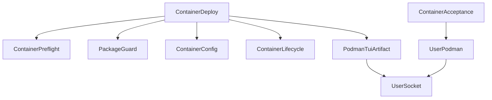
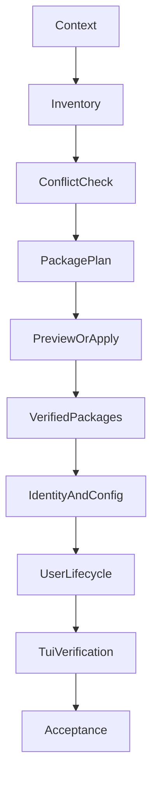

# Technical Design: Rootless Containers

## Overview
Port P07 and source podman-tui to the desktop account through the existing local pyinfra foundation. The implementation installs native Ubuntu tools, preserves existing runtimes and data, and exposes the source command forms with a user-only API.

### Goals
Rootless containers and Compose work as the owner, podman-tui connects to that same rootless API, repeat apply is idempotent, and restoration preserves data.

### Non-Goals
Privileged Docker installation; data migration/reset; universal Docker API or Compose-spec compatibility; desktop/GPU/login changes; global tuning; Snap/Flatpak or third-party apt repositories.

## Boundary Commitments

### This Spec Owns
- Container package manifest, preflight, subordinate-ID allocation, compatibility commands, container configuration and rootless lifecycle.
- Exclusive installation ownership of podman-tui, including its pinned artifact metadata and verification.
- Feature configuration backups, restoration and acceptance tooling. Container data and credentials remain user-owned.

### Out of Boundary
Foundation owns PackageGuard, apt policy, uv/nvm and shared deploy orchestration. Application-suite excludes podman-tui. Laptop-resource-policy owns global scheduling/power policy. Shell owns shell initialization. This feature does not edit their files or the existing GPU unit.

### Allowed Dependencies
- Foundation local-context validation, scoped sudo and PackageGuard; implementation is gated on those interfaces actually existing. Foundation task approval is still pending in the roadmap.
- Ubuntu 26.04 amd64, pyinfra 3.10.0 and systemd user manager/cgroup v2, verified at preflight. `/etc/os-release` currently identifies resolute; other releases require a reviewed manifest.
- Native Ubuntu packages below; HTTPS upstream podman-tui artifact under the separately reviewed feature-artifact route explicitly allowed by foundation design. No invented PackageRequest source variant.

### Revalidation Triggers
Changes to foundation signatures, Ubuntu suite or architecture, installed Podman/Compose versions, registry precedence, subordinate mappings, storage backend, API endpoint, compose-provider selection or cgroup placement require container acceptance to repeat. Consumers such as RDP revalidate only the container command/API contract when it changes.

## Architecture

### Existing Architecture Analysis
Local `deploy.py`, `tasks/tools.py`, `tasks/node.py` exist; no local container feature exists. Source revision `a1c09ec3f02a98b7c6a4641f907108a2ad080993` contains `tasks/containers.py`; podman-tui is in `group_data/all.py` and installed by the generic release loop in source `tasks/apps.py`. This design moves that one tool to this feature without importing the generic installer.

Core steering product.md, tech.md and structure.md are absent. The available roadmap, package policy, brief, source audit and approved foundation design supply scope; missing steering is a documentation limitation, not evidence of runtime compatibility.

### Architecture Pattern & Boundary Map
A thin pyinfra feature entry point orders bounded helpers; use upstream Podman/systemd behavior rather than a new container manager.



Dependency direction: immutable feature settings → preflight and local helpers → feature deploy orchestration. Helpers consume foundation services; foundation imports no feature code. Acceptance/restoration operate through the documented state receipt and user commands.

### Technology Stack

| Layer | Choice | Role |
| --- | --- | --- |
| Provisioning | uv-managed pyinfra 3.10.0 | Existing local execution |
| Engine | Ubuntu podman 5.7.0+ds2-3build1 candidate | Rootless runtime |
| Compose | Ubuntu podman-compose 1.5.0-2 candidate | Explicit provider |
| Compatibility | Ubuntu podman-docker matching engine | docker command |
| Networking/runtime | passt, netavark, aardvark-dns, crun, uidmap, catatonit | Explicit no-recommends prerequisites |
| Storage helpers | containers-storage; conditional fuse-overlayfs | Source utility and verified fallback support |
| API | systemd user podman.socket | Local Unix socket only |
| TUI | Upstream podman-tui v2.0.0 amd64 ZIP | Exact source pin, compatibility pending |

Candidate versions are evidence from current read-only apt-cache policy, not immutable guarantees. Review resolved versions, maintainer behavior and plan again on apply. Do not hard-code Debian forky artifacts or assume latest upstream options match installed packages.

## File Structure Plan

All implementation paths below are planned new files; this spec-generation run writes only spec documents.

| New repository file | Component and responsibility |
| --- | --- |
| `deploy_containers.py` | ContainerDeploy optional local entry point; no root deploy edit |
| `config/containers.json` | Exact manifest, source version/digest and explicit policy settings |
| `tasks/containers.py` | ContainerDeploy pyinfra ordering |
| `lib/container_preflight.py` | ContainerPreflight facts, conflicts and identity plan |
| `lib/container_config.py` | ContainerConfig owned fragments/links and identity application |
| `lib/container_lifecycle.py` | ContainerLifecycle user socket, linger, scheduling decisions |
| `lib/podman_tui_artifact.py` | PodmanTuiArtifact verified staging/install |
| `lib/container_restore.py` | ContainerRestore receipt and guarded restoration |
| `scripts/check_containers.py` | ContainerAcceptance read-only checks and explicit isolated smoke mode |
| `scripts/restore_containers.py` | ContainerRestore command entry |
| `tests/test_containers.py` | Contract/conflict/identity/artifact fixture checks |
| `tests/fixtures/containers/compose.yaml` | Uniquely scoped Compose acceptance fixture |

### Modified Files
None in this feature plan. Root orchestration and application-suite integrations are explicit owner-controlled follow-up work, not hidden edits in feature tasks.

Managed host paths: `/etc/containers/registries.conf.d/60-t2-containers.conf`, `/etc/containers/containers.conf.d/60-t2-containers.conf`, `/etc/containers/nodocker` only when newly created; `/usr/local/bin/docker-compose` only when absent or already feature-owned; `/usr/local/bin/podman-tui` and `/usr/local/share/t2-containers/podman-tui.json`; user lifecycle settings; optional `~/.config/systemd/user/user.slice.d/60-t2-containers.conf` only on explicitly validated source-weight adoption. State receipts and protected backups go in `~/.local/state/t2-containers/` with user-only access. Identity append operations touch `/etc/subuid` and `/etc/subgid` under their account-management locking; no blanket rewrite.

## System Flows



All fatal preflight conflicts stop before writes. Preview reports staged changes without downloads, identity writes, systemctl mutations, image pulls or container execution. Native package preflight and artifact route status are both visible. Apply records completed changes; later failure is nonzero and resumable, not automatic data rollback.

## Requirements Traceability

| Requirement | Summary | Components | Interfaces | Flows |
| --- | --- | --- | --- | --- |
| 1.1, 1.2, 1.4 | Preview and guarded errors | ContainerDeploy, ContainerPreflight | Foundation PackageRequest/PackagePlan | Preflight/apply |
| 1.3 | Preserve data/idempotence | ContainerConfig, ContainerRestore | Managed receipt | Repeat apply |
| 2.1, 2.2, 2.3 | Rootless prerequisites | ContainerPreflight, ContainerConfig | IdentityPlan | Identity apply |
| 2.4 | Runtime/network/storage | ContainerAcceptance | User Podman CLI | Smoke |
| 3.1, 3.2 | Compatibility ownership | ContainerPreflight, ContainerConfig | CompatibilityPlan | Setup |
| 3.3 | Compose workload | ContainerAcceptance | Compose fixture | Smoke |
| 3.4 | Image resolution | ContainerConfig | Registry disposition | Config |
| 4.1, 4.2, 4.4 | User API and linger | ContainerLifecycle | User systemd | Lifecycle |
| 4.3 | Scheduling | ContainerLifecycle | Cgroup facts/disposition | Policy evaluation |
| 5.1, 5.2 | Verified terminal UI route | PodmanTuiArtifact, ContainerAcceptance | Artifact manifest/user API | Install/verify |
| 5.3 | Restoration | ContainerRestore | State receipt | Restore |
| 5.4 | Honest acceptance | ContainerAcceptance | CheckResult | Report |

## Components and Interfaces

| Component | Intent | Coverage | Dependencies | Contracts |
| --- | --- | --- | --- | --- |
| ContainerPreflight | Read-only context/conflicts/identity plan | 1.1, 1.2, 1.4, 2.1, 2.2, 2.3, 3.1 | Foundation P0, account database P0 | Service |
| ContainerConfig | Owned configuration and compatibility | 1.3, 2.2, 2.3, 3.2, 3.4 | Preflight P0, guarded packages P0 | Batch/state |
| ContainerLifecycle | User-only lifecycle and resource decisions | 4.1, 4.2, 4.3, 4.4 | User bus/cgroup v2 P0 | Batch/state |
| PodmanTuiArtifact | Pinned dedicated artifact installation | 5.1, 5.2 | HTTPS artifact P0, local checksum P0 | Batch |
| ContainerRestore | Backup receipt and guarded recovery | 1.3, 5.3 | Feature receipts P0 | State/batch |
| ContainerAcceptance | Evidence and isolated smoke checks | 2.4, 3.3, 5.1, 5.4 | User runtime P0 | Service |
| ContainerDeploy | Preview/apply ordering and errors | 1.1, 1.2, 1.4 | Foundation P0, helpers P0 | Batch |

### ContainerPreflight and native package contract
Use exact foundation types and functions, imported from its implemented module location after that dependency is delivered:

```python
@dataclass(frozen=True)
class PackageRequest:
    packages: tuple[str, ...]
    source: Literal['ubuntu']

@dataclass(frozen=True)
class PackagePlan:
    installs: tuple[tuple[str, str], ...]
    removals: tuple[str, ...]

def validate_request(request: PackageRequest) -> None: ...
def inspect_plan(request: PackageRequest) -> PackagePlan: ...
def install_packages(request: PackageRequest) -> None: ...
```

Base request: podman, podman-docker, podman-compose, crun, passt, uidmap, netavark, aardvark-dns, catatonit, containers-storage; add native fuse-overlayfs only when storage readiness requires it and no migration is needed. Validate user-session prerequisites (dbus-user-session, user runtime directory, user bus) and request native dependencies if absent. No-recommends is foundation behavior. There is no upstream-artifact `PackageRequest` variant; never submit ZIPs, invented source values or raw installer shell through this API.

Collect OS/suite/architecture, user/home, cgroup v2 CPU delegation, namespace restrictions including Ubuntu AppArmor denial evidence, helper executables, effective registry/storage/engine configurations, environment overrides, existing Podman data and Docker commands/packages/services/contexts. Do not disable AppArmor or change global namespace sysctls to bypass a failure. Existing docker/docker-compose files, aliases, symlinks and package ownership are inspected before compatibility writes; conflicting installed Docker or a foreign DOCKER_HOST/CONTAINER_HOST/Compose provider causes a diagnostic stop, not package removal or shell edits. Existing unrelated Docker data is never read for migration or modified.

IdentityPlan contains user, existing UID/GID intervals, optional new interval, and conflict status. Preserve adequate existing ranges. If missing and no existing Podman store/process requires migration, select a free contiguous 65536-ID interval for each file after checking all accounts and actual UID/GID collisions; revalidate under account locks before application. Reject malformed/overlapping mappings and changes to existing mappings. Never run `podman system reset`, `system migrate`, prune or chown existing storage automatically.

### ContainerConfig
Explicit local dispositions evaluated from source:
- Retain source Docker command behavior using native podman-docker and an absent-or-owned `docker-compose` link to `/usr/bin/podman-compose`. Configure `[engine] compose_providers = ["/usr/bin/podman-compose"]` and `compose_warning_logs = false` only after installed-version parsing/CLI acceptance. This pins the provider independent of Docker Compose's default precedence. Environment overrides are surfaced as conflicts, never silently cleared.
- Retain source docker.io short-name search and permissive mode only on a clean configuration without user/admin policy conflicts. Existing registry policies, aliases, credentials and higher-precedence user files are preserved; conflict stops policy application with an explicit unresolved result. Fully qualified digest-pinned images are used for acceptance. Permissive mode is evaluated as source compatibility, not proof that short names identify trusted images.
- Create nodocker marker only with the compatibility setup and preserve an existing marker. Record file hashes, original ownership/mode, backups and whether paths predated this feature. Use marked dedicated fragments; refuse takeover of an existing foreign fragment.

### ContainerLifecycle
Enable **and start** user podman.socket, checking enabled and active separately (the source only checks enabled, so misses enabled-but-inactive state). Use the real desktop user bus and `/run/user/<uid>`, fail if unavailable rather than using root's manager. Endpoint is `unix:///run/user/<uid>/podman/podman.sock`; do not create a `/var/run/docker.sock` alias, change global DOCKER_HOST, expose TCP or start system-level Podman/Docker services. Verify restrictive socket permissions and owner.

Adopt source linger=true for login-independent user manager availability, recording previous state. Linger does not itself guarantee every manually launched container survives logout or restarts after reboot; validate only the selected workload lifecycle and socket readiness, with no automatic new workload units.

Evaluate source weight 200 against default sibling weight 100: it favors containers under contention. Default local disposition is **retain current effective scheduling, do not write the source weight** because laptop responsiveness and actual cgroup placement are unverified. Report this rejected automatic adaptation with effective placement/weights. Optional explicit source-weight adoption requires actual container scopes in the user manager's user.slice, delegated CPU controller and demonstrated sibling relationship; otherwise report unsupported. Never infer placement from the source comment or modify app.slice/session.slice/global user.slice. No benchmark or performance benefit is claimed.

### PodmanTuiArtifact
Dedicated feature artifact route; design/task fast-track approval approves this route's specification, not an observed successful installation. Exact source identity:
- URL: `https://github.com/containers/podman-tui/releases/download/v2.0.0/podman-tui-release-linux_amd64.zip`
- SHA-256: `de1de10344a8ab636c64c2f982bdaa4e05696b642e2dd4692872f56b3254442f`
- Expected executable/version: `podman-tui`, v2.0.0, Linux amd64. Source metadata is not independent checksum verification.

Native apt is used only if a separately reviewed suite candidate exists; current apt-cache provides no podman-tui candidate. This design therefore specifies the pinned upstream artifact. HTTPS fetch to a fresh private temporary directory as the desktop user; verify archive SHA-256 before extraction/execution. Reject absolute paths, traversal, symlinks/hard links/device entries and oversized archives; extract only one unambiguous regular executable named podman-tui with a configured size limit (256 MiB archive and executable ceiling). Verify ELF architecture, executable version and dynamic library availability before privileged atomic installation. No privileged download/extraction, archive-provided scripts or dependency auto-installers. Use only separately guarded native dependencies, never Snap/Flatpak.

Refuse replacing an existing unowned binary or marker. Store provenance and installed-file digest; idempotence requires both content digest and expected version, not only a marker file. Clean staging on all exits. Final API smoke must list the test container through the desktop user's Unix socket, with credentials/configuration untouched. Digest mismatch, missing asset or incompatible API blocks TUI success; no latest-version fallback. Foundation's permitted separately reviewed feature-artifact design is the route; if upstream policy is later narrowed to native-only, this component becomes explicitly blocked until reviewed, without extending PackageGuard here.

### ContainerRestore and state model
Receipt entries contain path, previous existence/type/hash/mode/owner, protected backup path and applied hash; lifecycle entries contain previous linger/enabled/active values. Write receipt before each mutation and completed status after it. Restoration refuses to overwrite post-apply user changes and reports conflicts. Restore only owned fragments/link/binary and prior socket/linger settings, reload the user manager, and never remove user containers/volumes, packages shared with others, credentials or newly used subordinate ranges. Do not automatically remove identity allocations: they can become data ownership contracts. Preserve them with an explicit retained-state report.

### ContainerAcceptance
`check_containers(smoke: bool = False) -> tuple[CheckResult, ...]`, with each result carrying check name, status `pass|fail|pending|not_applicable`, evidence and reason. Read-only mode runs no workload or image pull. Explicit smoke mode creates a unique project prefix, owned temporary directory, labels and volume names; pins approved image digests in the fixture. Cleanup only labelled resources recorded in that run, preserves volumes unless demonstrably test-owned, and retains failure evidence. No prune or broad down commands. Full feature success requires all mandatory runtime paths; pending checks cannot become pass.

## Error Handling
Invalid context, conflicts and plan removals stop before mutation. Account allocation races restart bounded inspection once then fail. Download or verification failures leave the old executable untouched. Partial user-manager/configuration failures report nonzero and completed receipt entries for targeted restore. Network unavailable means runtime acceptance pending/fail, never assumed success. Output excludes registry secrets and environment credential values.

## Testing Strategy

Use Python standard-library unittest fixtures through the existing locked Python environment; task 1 establishes the harness before implementation tests. No unlisted pytest dependency is assumed.
- Contract fixtures: rejected PackageRequest routes/prohibited dependency/removal plan; non-mutating preview; repeat apply produces no duplicate fragments or allocations (1.1–1.4).
- Identity/storage fixtures: existing mappings retained, missing ranges allocated without collisions, overlap/races/active storage rejected; Ubuntu namespace denial diagnosed without bypass (2.1–2.3).
- Compatibility fixtures: Docker executable/package/context conflicts, foreign compose link/provider environment and overriding registry config stop without writes; installed-version config parsing proves selected provider (3.1, 3.2, 3.4).
- Lifecycle fixtures and user-session integration: enabled-but-inactive socket starts, masked socket reports failure; owner/mode/endpoint checked; effective cgroup ancestry and retain-policy reported; restore prior linger/socket states (4.1–4.4, 5.3).
- Artifact fixtures: bad digest, traversal, duplicate executable, wrong architecture, marker/content mismatch and foreign binary all fail safely; API/version smoke on real host remains mandatory (5.1, 5.2).
- E2E: desktop-user `podman info` rootless=true; approved digest image runs with DNS/outbound network; dedicated volume persists through stop/recreate; four compatibility forms identify the same provider; two-service Compose fixture resolves a peer and reads persisted data; podman-tui lists that same test workload; cleanup preserves pre-existing resources (2.4, 3.2, 3.3, 5.1).
- Repeat/restore integration compares preflight snapshots and feature-owned hashes, package plans, identities and lifecycle state; logout/relogin and reboot checks are manual pending until actually observed (1.3, 4.2, 5.3, 5.4).

## Security Considerations
User API access permits code execution as that account; retain Unix permissions and never expose it on TCP. Registry policy is preserved or explicitly applied, credentials never copied, and smoke images are fully qualified/digest pinned. Identity changes are append-only and collision checked; existing data is not migrated. Archive verification and unprivileged extraction precede sudo installation.

## Migration Strategy
Preflight → preview → guarded native install → prerequisite/config apply → user lifecycle → independently verified TUI artifact → explicit smoke. No existing container storage migration is authorized. Each phase records its own completed state; restoration does not imply package/data deletion. Foundation implementation and approved local invocation remain prerequisites; none of these operations have run during spec generation.

## Subsequent protected-system clarification

Read .kiro/steering/protected-system-boundary.md and t2-hardware-policy.md.
The owner's strict no-go prohibits direct and indirect cryptsetup/LUKS/LVM,
fstab/swap/resume, kernel/module/header, bootloader and initramfs/mkinitcpio
changes/regeneration. All feature dependency operations must pass that foundation
plan gate; unknown maintainer-script/trigger effects block the affected plan.
No autoremove, boot rebuild, protected-file rollback or hardware-driver changes.
Preserve the fresh T2 hardware stack and dormant installed KDE. Read-only
baseline and live hardware acceptance are separate; no runtime success is claimed.
