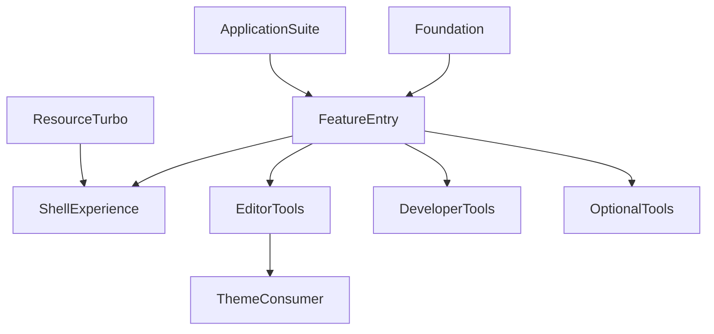

# Design Document

## Overview
Port P10–P13 through an optional local pyinfra feature, retaining actual source shell/editor/tool behavior while adapting unsafe VM assumptions. The owner can use it from KDE immediately; Hyprland and coordinated themes are independent consumers.

### Goals
Deliver grml-inspired Bash, nvim-simple and selected user tools with immutable inputs, explicit optional profiles, non-mutating preview and scoped restoration. Report capability and runtime acceptance independently.

### Non-Goals
No terminal palettes/configuration, desktop theme bridge, compositor, container runtime, native app installers, authentication provisioning, snitch cleanup or root deploy changes. No protected boot/storage/hardware mutations or KDE removal.

## Boundary Commitments

### This Spec Owns
- Optional tool entry point, selected tool manifest, shell-user-tools results/state and restoration.
- One distinct `.bashrc` block, Bash fragments, managed readline include and per-command user completions.
- nvim-simple base/configuration/plugin deployment, excluding the theme-owned plugin below.
- User Node/Python/agent tools, ax isolated build and optional rclone mount/cache-report/Quarto user artifacts.

### Out of Boundary
Foundation owns `.nvmrc`, Node/nvm provisioning, its marked `.bashrc` block, uv bootstrap/lock and shared preflight/package guard. Resource policy owns `~/.config/t2-mac-kde/turbo.bash`; shell only sources it. Application-suite owns neovim, rclone, gh, kubectl, helm, rc, Go, Quarto and other native/release executables; shell re-probes availability. Coordinated themes owns terminal configs, all palette integration, and `~/.config/nvim/plugin/debian-hypr-theme.lua`; shell must never create, replace or delete that path, including during editor upgrades/restore. Fonts owns font installation; nvim-simple uses its source ASCII settings and does not require Nerd glyphs. Root orchestration edits remain foundation/integration work.

### Allowed Dependencies
Consume exactly foundation `manage.preflight.validate_local_context() -> None` and `manage.packages.PackageRequest(packages: tuple[str, ...], source: Literal['ubuntu'])`, `validate_request`, `inspect_plan` and `install_packages`; `PackagePlan.installs` holds package/version pairs and `removals` package names. There is no foundation arbitrary installer API. User artifact/package routes in this feature are separately reviewed contracts below. Native dependencies are Ubuntu-origin requests, with an additional feature preflight that blocks unknown or protected maintainer-script/trigger behavior; it does not change the shared API. Foundation implementation/readiness and strengthened protected-system enforcement must be verified before apply. No runtime dependency on KDE services or Hyprland for core tools.

The strict protected-system boundary applies to every installer, build, cleanup and restore: no cryptsetup/LUKS/LVM/fstab/crypttab/swap/resume, kernels/modules/headers, bootloader, initramfs/mkinitcpio configuration or artifact mutations, even indirect package hooks; no autoremove/full upgrade, DKMS or driver changes. Unknown trigger behavior is blocking. Read-only inventory may record accessible hashes without exposing confidential decryption configuration.

### Revalidation Triggers
Changes to turbo path, foundation block/order/runtime, application executable paths, nvim revision/plugin pins, Safe Chain integration or tool package versions require consumer checks. Theme-owned path changes require shell/theme review. Mount/FUSE or user-service changes require unit validation; protected-system policy/package resolution changes invalidate install approval.

## Architecture

### Existing Architecture Analysis
Local `tasks/node.py` and `tasks/tools.py` provide the small foundation only. Source `tasks/shell.py` overwrites `.inputrc`, adds several blocks and executes xfconf; `tasks/user_tools.py` writes an nvm-incompatible prefix, downloads moving packages, suppresses plugin failures and enables deletion nightly. Adopt assets/behavior selectively instead of copying deploy scripts. Core product/tech/structure steering files are absent; available roadmap and package/audio/T2/protected-system policies were read.

### Architecture Pattern & Boundary Map
Small typed Python modules plus Bash/native user units. Dependency direction: immutable feature manifest and foundation APIs → feature operations → optional entry point; downstream themes consumes editor state and supplies its own files. No custom installer framework or resident service.



### Technology Stack
| Layer | Choice/version | Role and gate |
|---|---|---|
| Provisioning | Python >=3.11, uv locked pyinfra 3.10.0 | Existing environment only |
| Shell | Installed Bash/readline, Ubuntu bash-completion | Verify installed behavior; no shell replacement |
| Editor | app-owned Neovim; nvim-simple `70717b469ce15ade8b1186c3650a484a5202cb75` | Pin five plugins and vim-plug separately before network activation |
| User tools | foundation-selected nvm/Node and existing uv | Exact reviewed package versions; no `.npmrc` prefix |
| Protection | Safe Chain 1.5.25 | Release installer source pin/digest below; binary and wrapper review pending |
| ax | v0.3.1, GOTOOLCHAIN=go1.27.2 | Source go.mod requires >=1.27.1; verify Go checksum/download permission before build |
| Optional | app-owned rclone/Quarto, systemd user manager/FUSE3 | Explicit selection; availability is not runtime proof |

## File Structure Plan

All are planned feature-owned paths; no implementation is written by this spec.

| Repository paths | Component and responsibility |
|---|---|
| `config/shell-user-tools.json` | FeatureEntry: selected profiles, reviewed package/artifact pins, expected capabilities; no secrets |
| `manage/shell_user_tools.py` | FeatureEntry: validate manifest, prerequisites, protected package/hooks, backups/status/restore; foundation API consumer |
| `tasks/shell_user_tools.py` | FeatureEntry: optional pyinfra entry with ordered operations; no root deploy edits |
| `tasks/shell_experience.py` | ShellExperience: shell/readline/completion orchestration |
| `files/bash/grml.bash`, `files/bash/history.bash`, `files/bash/user-tools.bash`, `files/bash/readline.inputrc` | ShellExperience: adapted source prompt/helpers/history, loader and readline settings |
| `manage/nvim_simple.py` | EditorTools: staged config/plugin integrity, compatibility and replacement |
| `config/nvim-simple-lock.json` | EditorTools: exact nvim source, vim-plug, five plugin commit/digest records |
| `tasks/developer_tools.py`, `manage/developer_tools.py` | DeveloperTools: selected npm/uv/Safe Chain/agent packages and isolated ax build |
| `tasks/optional_user_tools.py`, `manage/optional_user_tools.py` | OptionalTools: mount/Quarto and report-only timer operations |
| `files/bin/dev-disk-reclaim`, `templates/user-tools/rclone.service.j2`, `files/systemd/user/dev-disk-reclaim.service`, `files/systemd/user/dev-disk-reclaim.timer` | OptionalTools: bounded cache helper, safe mount and reporting units |
| `tests/test_shell_experience.py`, `tests/test_nvim_simple.py`, `tests/test_developer_tools.py`, `tests/test_optional_user_tools.py`, `tests/test_shell_user_tools.py` | Corresponding components: fixture/subprocess/disposable-home and integration acceptance |

Managed target paths: shell block `# BEGIN/END t2-mac-kde: shell-user-tools`; `~/.config/bash/{grml,history,user-tools}.bash`; `~/.config/bash/readline.inputrc`; one marked include in `.inputrc`; only generated provider files in `~/.local/share/bash-completion/completions/{kubectl,k,helm,gh,ax,rc}`. Other targets: `~/.config/nvim` with excluded theme path; `~/.safe-chain` owned reviewed subset; nvm's selected-version global tool prefix; uv's isolated euporie environment, `~/.claude/skills/pretty-mermaid`; `~/.local/bin/ax`, `dev-disk-reclaim`; selected mount/cache user units; staged Quarto environment under `~/.local/share/quarto-python`; selected `~/.TinyTeX`. State/backups in `$XDG_STATE_HOME/t2-mac-kde/shell-user-tools` (default `~/.local/state/...`), mode 0700; reports omit tokens/history/config credentials.

## System Flows
Preview reads facts and prints plan only. Apply validates context, manifest completeness, executable conflicts and selected prerequisites before any mutation. It then guards native dependencies, stages/validates user artifacts and installs atomic owned replacements. Shell loader is installed last so partial tool installation is not advertised. Required selected failures return nonzero; optional unselected profiles remain listed as unselected. No catch-all success masking.

## Requirements Traceability
| Requirement | Summary | Components | Interfaces | Flows |
|---|---|---|---|---|
| 1.1, 1.2, 1.3, 1.4, 1.5, 1.6 | Source shell with session safety | ShellExperience | marked loader/turbo/completions | new terminal |
| 2.1, 2.2, 2.3, 2.4, 2.5 | Recoverable simple editor | EditorTools | pinned editor state/theme exclusion | stage/validate/publish |
| 3.1, 3.2, 3.3, 3.4, 3.5 | Isolated user development tools | DeveloperTools | reviewed manifest/runtime | selected install |
| 4.1, 4.2, 4.5 | Protection and ax | DeveloperTools | Safe Chain/isolated Go | protected install |
| 4.3, 4.4 | Tool-matched completions | ShellExperience | executable completion commands | generate/publish |
| 5.1, 5.2, 5.3, 5.4, 5.5 | Explicit optional profiles | OptionalTools | units/cache/Quarto | selected apply |
| 6.1, 6.2, 6.3, 6.4 | Preservation and recovery | FeatureEntry, all operations | guards/state | preview/apply/restore |
| 7.1, 7.2, 7.3 | Honest execution evidence | FeatureEntry | results/exit | every operation |

## Components and Interfaces

| Component | Intent | Requirements | Dependencies | Contracts |
|---|---|---|---|---|
| FeatureEntry | Validated optional orchestration and restore | 6.1–6.4, 7.1–7.3 | Foundation outbound P0; application report external P1 | Service, Batch, State |
| ShellExperience | Bash/readline and completions | 1.1–1.6, 4.3–4.4 | resource fragment external P1; app executables external P1 | Batch, State |
| EditorTools | Pinned staged Neovim base | 2.1–2.5 | Neovim external P0; source/plugin repositories external P0; themes inbound P1 | Batch, State |
| DeveloperTools | nvm/uv tools, protection, ax | 3.1–3.5, 4.1–4.2, 4.5 | nvm/uv external P0; registries/releases external P0 | Batch, State |
| OptionalTools | Mounts, cache reports, Quarto | 5.1–5.5 | app executables external P0 when selected; user bus/FUSE external P0 for mounts | Batch, State |

### FeatureEntry
```python
from dataclasses import dataclass
from typing import Literal
from pathlib import Path

@dataclass(frozen=True)
class ToolResult:
    capability: str
    status: Literal['unselected', 'blocked', 'failed', 'installed', 'configured', 'running', 'restored']
    version: str | None
    authenticated: bool | None
    evidence: tuple[str, ...]
    reason: str | None

def validate_selection(manifest: Path) -> None: ...
def observe_tools() -> tuple[ToolResult, ...]: ...
def restore_tools(snapshot: Path) -> tuple[ToolResult, ...]: ...
```
Inputs are validated paths/IDs, exact versions/revisions/digests and booleans; no arbitrary installer command strings. Unknown selections/path escapes/symlink conflicts fail. Native install uses exact foundation calls above, never relabels vendor packages as Ubuntu. Inspect package scripts/triggers before install; unknown protected effects block even if apt simulation has no removals. Check app report schema_version=1 at `$XDG_STATE_HOME/t2-mac-kde/applications.json`, re-probe binaries directly; stale/missing report means unknown, not success. Shell may observe already-installed prerequisites without installing apps it does not own.

State records per-path absent/present, digest, owner/mode/symlink and per-unit prior enabled/active state, owned npm/uv package version and selected runtime. Backups are unique, never overwritten; restoration refuses later edits and never removes unrelated tools or restores forbidden protected paths. Packages remain installed on restore. Dry-run creates no state or backup. Apply/report writes feature results; observation is read-only.

### ShellExperience
Batch trigger is optional feature apply. A single marked loader sources readable fragments only for interactive Bash, after the foundation block. Enforce ordering without modifying its block; ambiguous user return/exec or conflicting managed blocks fail with a diagnostic. Foundation's nvm remains authoritative. Avoid re-prepending `.local/bin` when foundation already supplied it. Load grml first, then history hooks, optional Safe Chain wrappers, then the resource turbo fragment; sourcing twice is idempotent.

Preserve source shopt conveniences, color aliases, `k=kubectl`, directory stack, `mkcd`, `cdt`, `bk`, `sll`, `ssearch`, Git status prompt/title. Adapt directory stack to enforce its intended 20-entry bound (source merely assigns DIRSTACKSIZE). Preserve argument boundaries and error statuses. Readline adds one marked `$include` of feature settings, retaining existing file and `/etc/inputrc` behavior. Source values: HISTSIZE=100000, HISTFILESIZE=200000, HISTCONTROL=ignoreboth:erasedups, timestamp `%F %T  `, source HISTIGNORE, histappend/cmdhist and append/read at each prompt. Preserve scalar or array PROMPT_COMMAND and the previous command's status; do not duplicate hooks or read/log history contents during reporting.

Source `kbus`, `kbde` and setxkbmap shim activate only when Hyprland is the current session and executable `hypr-kbd` exists; ordinary KDE/X11 commands retain native behavior. Graphical layout requests delegate to desktop-owned hypr-kbd without altering its source de,us/mac_nodeadkeys baseline, Option+L=@ or source Super mapping; no console/login/unlock keyboard policy is touched. Never export `COPILOT_GITHUB_TOKEN` via `gh auth token` at startup. No xfconf calls or terminal ownership here. Uutils PATH precedence is an explicit optional compatibility profile, disabled until application-suite supplies a reviewed implementation/path; source `/usr/lib/cargo/bin/coreutils` is Debian evidence, not an assumed Ubuntu path. GNU commands remain default.

Completion providers are exact live commands: `kubectl completion bash`, `helm completion bash`, `gh completion -s bash`, `ax completion bash`, `rc completions bash`. Use app-selected absolute executable paths; verify supported command with installed version first. Generate to temporary files, require zero exit and Bash syntax success, then replace only own provider files. `k` loads kubectl's function and binds `complete -o default -F __start_kubectl k` after verifying the function exists. Missing/failed providers become unavailable and stale owned output is disabled; never overwrite unmanaged output.

### EditorTools
Source nvim-simple pin above supplies CUA Ctrl-C/V/X/A/S/Z/Y, F10/space-space menu, F2 explorer, F3 terminal, tabs, F4 Berg toggle and ASCII airline/QuickUI/devicon settings. Pin vim-plug plus `skywind3000/vim-quickui`, `vim-airline/vim-airline`, `vim-airline/vim-airline-themes`, `preservim/nerdtree`, `ryanoasis/vim-devicons` in nvim lock. The upstream config pins none and auto-fetches vim-plug master; patch only that bootstrap/plugin resolution to reviewed immutable inputs. Record source/adaptation digests and include Berg colors from the same revision. No first-launch network access or unbounded plugin update.

Build in a staging XDG home, verify exact source/plugins, `nvim --headless` initialization with bounded timeout and explicit failure detection; a quickui directory alone is not success. Validate menu commands/keymaps/color files, startup error output and editor version, then atomically publish feature-owned files. Never copy source's malformed temporary cleanup string, `rm -rf nvim.lazyvim`, broad Lazy/Mason/cache deletion or `|| true` plugin install. Back up all replaced configs uniquely; preserve unrelated data. Theme-owned plugin stays in place untouched throughout update and restore; use per-file publication/exclusion and preserve its directory. If an existing config cannot be separated safely, block replacement for review. Clipboard provider is supplied by apps/session; headless validity is separate from live clipboard/menu/key behavior.

Published editor contract: `~/.config/nvim` is a valid standalone nvim-simple base with `colors/berg.vim`, `colors/berg-light.vim`, `ToggleTheme()` and airline APIs from its verified pin; coordinated themes owns its independent plugin file and may consume this base after validation. Pin/API changes require theme review. Font resolution belongs to fonts/themes; no mandatory glyph setting is introduced.

### DeveloperTools
Separately reviewed feature contract: exact package version, registry URL/integrity and reviewed dependency/install-script behavior are committed before execution; source unpinned pnpm/@github/copilot/@openai/codex/ccusage/euporie/skills commands are inventory only. Resolve and review immutable versions in implementation setup; missing pins block selected capability before mutation. Native dependencies must use the guard; package scripts may not invoke privileged package installation or protected hooks. No generic fallback to curl-pipe-shell or moving npx.

For each npm operation use a fresh Bash that sources foundation nvm and selects the exact repository Node version. Confirm `npm prefix -g` belongs to that nvm version; never write `.npmrc`, set prefix or install system Node. Compare actual package versions/executable resolution, not `~/.local/bin` presence. Explicitly preserve other Node installations and package sets; new Node selection requires revalidation/reinstallation of selected tools only. Login remains manual with CLI-supported native flows; no global credential injection or shell startup authentication command.

Use existing uv, `uv tool install euporie==<reviewed-version> --with ipykernel==<reviewed-version>` with reviewed dependency resolution; verify the kernel in euporie's own environment, not system Python. Avoid source reinstall of uv. Pretty-mermaid uses a pinned reviewed skills CLI and immutable skill repository revision in an isolated staging home, validates resulting `SKILL.md` and only publishes `~/.claude/skills/pretty-mermaid`. Review CLI source/flags at chosen pin before executing; the moving source command is not an approved route. Preserve agent config and unrelated skill directories.

Safe Chain source version=1.5.25, release installer URL `https://github.com/AikidoSec/safe-chain/releases/download/1.5.25/install-safe-chain.sh`, source SHA256 `83069f6db4215cccf6a26bdd6e65a5c2366b9d24322b2d5d2862d47385e56682`. The tagged source installer template has empty binary checksums, may look up latest, removes npm/Volta/nvm installations and calls setup across profiles. Do not execute it against the owner's home. Obtain and verify the actual release installer/binary in staging, confirm version and binary digest, audit generated scripts and capture the resolved tag commit. Adopt only reviewed binary/wrapper files and selected package-manager wrappers in this feature's loader; no upstream setup/teardown against live profiles. Tagged shell docs confirm `aikido-*` wrappers and `npm/pnpm/pip/uv safe-chain-verify`. Verify generated command paths/runtime selection and noninteractive invocation at this exact release before enabling. Preserve other wrappers or report conflict; never silently replace them. No assumed shell-function protection in noninteractive pyinfra commands: protected install paths explicitly invoke the reviewed wrapper with selected underlying runtime; if the release cannot meet this contract, selected protection is blocked. Do not claim arbitrary absolute-path subprocesses are protected.

ax uses `github.com/google/ax/cmd/ax@v0.3.1`, GOTOOLCHAIN=go1.27.2 and GOBIN set to staging. Native Go availability comes from application-suite; Go auto-toolchain fetch is a separate reviewed checksum/provenance prerequisite, never assumed. Use private GOCACHE/GOMODCACHE; preserve shared caches and avoid source `go clean -cache -modcache`. Verify binary build info/version/completion before atomically publishing owned `~/.local/bin/ax`.

### OptionalTools
Selections are explicit manifest booleans/maps, independent of hostname; all optional services default disabled/unselected. No source onedrive remote or VM client role is inferred.

Mount entries contain validated remote ID and a relative home mount directory. Reject metacharacters, traversal, symlinks, nonempty targets, duplicate/nested mounts and conflicts with existing mounts/units. Re-probe application-owned rclone; use its exact resolved absolute path, not source `/usr/local/bin/rclone`. Require native FUSE3/fusermount3, access to `/dev/fuse`, existing owner-configured remote and reachable user manager. Inspect remote names only, never credential configuration. Use `Type=notify`, foreground `rclone mount`, `--vfs-cache-mode full --vfs-cache-max-size 2G --dir-cache-time 5m`, explicit config/cache paths in user scope, bounded failure/backoff and ExecCondition for remote. Escape systemd specifiers/arguments and use a validated unit basename. `After=network-online.target` is ordering only, not network readiness. Activate only selected eligible mounts, verify mount table/read access; pending conditions are not running. Restore stops only newly activated units and never deletes mount directories/data or remote config. Do not enable lingering or privileged FUSE changes.

Cache helper deliberately changes actual source behavior: default and timer ExecStart both `dev-disk-reclaim --dry-run`. Source helper deletes by default, prunes container volumes and supports apt autoremove; all those routes are excluded. No sudo branch, container/builder/image/volume pruning, browser-engine cache deletion, pre-commit patch deletion, agent logs or general `/tmp` tree deletion. Supported apply scope is explicitly selected regenerable package caches via verified native commands (uv prune without force, npm cache verification, pnpm store prune), plus owner-approved stale Cargo target trees under the user's cache with canonical path/CACHEDIR.TAG checks and no symlink traversal. Never delete environments, live nvm/uv/agent installs, project trees, mounts or protected system paths. Report-only mode does not invoke pruning commands or write a lock/state file; apply uses a user-private lock and reports actual failures. Timer retains source 03:30/Persistent scheduling only on explicit report-timer selection; no scheduled deletion. Destructive selected actions are irreversible and reported as such, never covered by file rollback.

Quarto prerequisites belong to application-suite. Python profile uses staged uv environment and source exact packages `nbclient==0.11.0`, `nbformat==5.11.1`, `ipykernel==7.4.0`, `jupyter-client==8.10.0`, `pyyaml==6.0.3`, with a reviewed full dependency lock before execution. Publish only after kernel/render checks; no `uv venv --clear` against a working environment. Export QUARTO_PYTHON only when this selected environment passes checks. TinyTeX is a distinct optional route: `quarto install tinytex --no-prompt` downloads further artifacts and is blocked until the selected Quarto version's installer, immutable TeX inputs and install destinations/dependencies are reviewed; no invented pin or approval by executable presence. Preserve any existing `.TinyTeX`, with conflict rather than overwrite. Source package pins are evidence, not proof of Ubuntu or Python compatibility.

## Data Models
Manifest schema_version=1 records capability ID, selection, route, exact version/revision, expected digest/integrity, runtime requirements and review disposition. State distinguishes configured/installed from authenticated/running and retains no credential values. App report is consumed read-only; shell results never rewrite it. Editor success requires all locked inputs plus executable tests; marker files alone are insufficient.

## Error Handling
Invalid manifest, conflicting ownership, missing runtime, unknown hooks, digest mismatch and protected effects block before affected mutation. Stage failures retain working files. Partial apply records exactly completed steps and returns failure; rerun checks actual state. Missing optional mounts/profiles are explicit pending/unselected results. Restore refuses edited files and cannot reverse cache deletion; it does not touch protected boot/storage state.

## Testing Strategy
- 1.1–1.6: disposable homes test scalar/array prompt hooks, prior exit status, repeated sourcing, spaced paths, bounded directory stack, history append/read, readline keys, unreadable turbo fragment, no startup sysfs mutation and KDE/Hyprland keyboard dispatch. Noninteractive shell must stay quiet.
- 2.1–2.5: stage nvim with locked plugins; reject digest mismatch, offline failure, timeout and emitted init errors; assert keymaps/menu/explorer/Berg files. Existing LazyVim/unrelated data and theme-owned plugin survive update/restore. Live clipboard/key handling remains session acceptance.
- 3.1–3.5, 4.1–4.2, 4.5: disposable runtime test selected nvm prefix, package exactness, no sudo/system Python writes, euporie kernel, staged skills conflict, Safe Chain verify/wrapper conflict/runtime and noninteractive paths; ax toolchain/build info/private caches. Deny moving or unreviewed inputs.
- 4.3–4.4: provider success/missing/failed/malformed output and non-conflicting atomic completion publication; k binding only when matching kubectl function exists.
- 5.1–5.5: systemd-analyze user-unit verification, hostile remote/path/percent input, missing FUSE/bus/remote, preexisting files/mounts; timer/helper default filesystem unchanged, apply allowlist and symlink escape denial; no destructive source branches. Quarto dependency failure preserves environment and TinyTeX gate blocks unreviewed downloads.
- 6.1–6.4, 7.1–7.3: preview managed-file/package/service snapshots unchanged; reject protected package/hook fixtures, Snap/Flatpak and all removals; repeat apply no changes; restore later-edit conflicts and unit ownership. Capture accessible protected/T2/login configuration hashes without secrets and never mutate them.
- Planned host acceptance: new terminals in KDE and later standalone Hyprland expose nvm, shell, editor, completion and selected protected tooling; verify live clipboard, notebook kernel and optional mount as configured. T2 microphone/speakers/camera/touch-bar/input/suspend checks remain explicit unverified host gates. No physical behavior is inferred from package presence or static review.

## Security Considerations
No source credentials/licenses, global shell token export, arbitrary installer command strings, privileged npm/pip or hidden installer fallback. Integrity and script/trigger review are required before execution. Logs redact authentication details/history. Protection status reflects verified wrapper coverage only.

## Migration Strategy
Deliver optional entry without root inclusion. Resolve reviewed tool locks/prerequisites first, stage user tools/editor, validate, then add distinct shell loader. Back up only changed owned paths; retain legacy config/data until validation and never purge Lazy/Mason or old backups. Restore owned files and selected unit states with conflict detection; preserve themes, foundation, resource policy and protected system. No deployment, live service activation, cleanup or runtime acceptance occurred while generating this specification.
