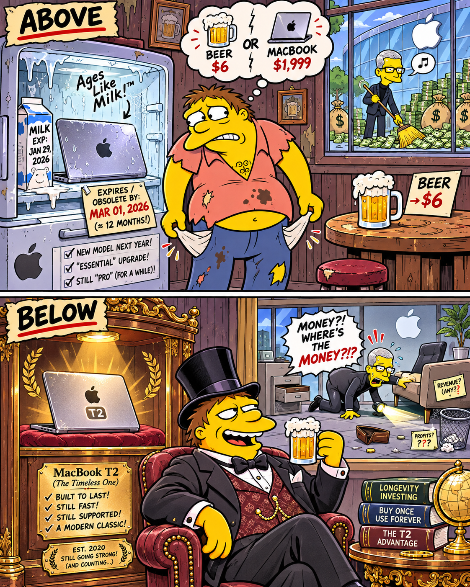

# Intel MacBook Pro on Linux

<p align="center"></p>

Apple is winding down macOS support for Intel Macs. I didn't want to retire a perfectly good
MacBook Pro over that, so this repository turns an Intel/T2 MacBook Pro into an Ubuntu 26.04
LTS workstation. Ubuntu supports 26.04 until 2031. The whole setup is one pyinfra deploy you
can read before you run it, and every personal choice can be switched back off.

I use it daily on a MacBook Pro 16" 2019 (MacBookPro16,1). Other T2 models should mostly work,
but I haven't tested them.

## Why bother

Ubuntu 26.04 LTS gets security updates until 2031, well past the end of macOS updates for
Intel Macs. On my machine the hardware works: speakers, microphone, Wi-Fi, Bluetooth,
keyboard, trackpad, Touch Bar, camera and suspend. Touch ID is the one thing that doesn't. It
lives inside Apple's Secure Enclave, and Linux has no driver for it, so you type your password.

People who have switched report that Linux runs 20–30% faster than macOS on the same Intel
hardware. Treat that as a claim and measure your own workload.
The machine is tuned as a quiet, cool, low-power tool, not a powerhouse: turbo off, fans at
their minimum, so you can think about the task instead of the noise. In that setting it still
runs OS work 2-4 times faster than macOS on the same hardware
([Linux vs macOS on the same Mac](docs/benchmark.md): how well each OS is optimized for this
hardware).

## The desktop

The desktop is Hyprland: a tiling desktop you drive from the keyboard, set up by this
repository for code, terminals, containers, AI agents and remote desktop all day.

KDE Plasma stays installed but dormant. Kubuntu is the base because it gives this machine
Ubuntu's support lifetime; the repo doesn't configure or improve the KDE session, it just
leaves it working as the T2 install set it up. It's one logout away if you ever need it.

## What you get

- [Desktop](docs/desktop.md): Hyprland with Waybar, German Mac and US keyboard, screenshot editor, five themes.
- [Battery and heat](docs/power.md): turbo off by default, a charge limit, the AMD GPU idle, zram, earlyoom.
- [Audio](docs/audio.md): a crossover and bass DSP for the six speakers, a Boom3D-style headphone chain.
- [Developer tools](docs/developer-tools.md): grml Bash, nvm, uv, rootless Podman, KVM, icx, [Nix](docs/nix.md) CLI tools.
- [Apps](docs/apps.md): the Craft office suite, LibreOffice with the ribbon UI, VS Code, Zed, Chromium, Zoom.
- [Remote access](docs/remote-access.md): Tailscale, SSH behind fail2ban, RDP into Hyprland over Tailscale only.

Switching from a Mac? [Coming from macOS](docs/coming-from-macos.md) maps the apps you used
(iStat Menus, Boom3D, Office, Adobe, OneDrive) to what's here.

## What it never touches

Disk encryption (LUKS/LVM), `fstab`, kernels, the bootloader and the initramfs are on a strict
no-go list. Every package install goes through a guard that blocks Snap/Flatpak, protected
packages and removals, and scans each package for boot or encryption hooks first. The one
exception is an opt-in switch for CPU mitigations. Details: [docs/safety.md](docs/safety.md).

## Quick start

```sh
git clone https://github.com/norandom/intel-macbook-pro-linux.git ~/Source/t2-mac-kde
cd ~/Source/t2-mac-kde
sh bootstrap.sh                                               # uv + pinned pyinfra, no sudo

.venv/bin/pyinfra @local deploy.py --dry --use-sudo-password  # see every change first
.venv/bin/pyinfra @local deploy.py --use-sudo-password        # apply
```

Then log out and choose Hyprland at the login screen, or stay on KDE. Each part also runs on
its own, for example `.venv/bin/pyinfra @local tasks/speaker_dsp.py --use-sudo-password`. Run
everything as your normal user; only the system changes ask for your sudo password.

## Make it yours

Your own settings go in `~/.config/t2-mac-kde/config.toml`, never in the repository. The deploy
keeps a commented `config.example.toml` next to it. Every key, its default and the task that
reads it: [docs/configuration.md](docs/configuration.md). For changes beyond the config, such as
another keyboard layout, other key bindings, apps or bar modules, see
[docs/forking.md](docs/forking.md).

## Handy commands

| Command | What it does |
|---|---|
| `turbo-on` / `turbo-off` | Intel turbo boost on or off (off after every boot) |
| `t2-battery status` / `full` | battery health and charge limit; `full` before a trip |
| `hypr-gpu external` / `battery` | use the external display ports, or the Intel GPU only |
| `hypr-3d stage` / `off` | headphone 3D preset, or effects off for an A/B comparison |
| `hypr-termtheme next` | next terminal and editor theme (SUPER+Y) |
| `t2-nix-update` | update every Nix tool at once |

The full list: [docs/commands.md](docs/commands.md).

## Is it for you?

Probably not yet if:

- your Mac isn't a T2 MacBook Pro or Air from 2018–2020 (the MacBookPro16,1 is the one I know
  works);
- you depend on Touch ID, or on macOS-only apps with no Linux version;
- you can't make a backup first. This repository doesn't touch your disk layout, but the T2
  Linux install you start from does.

You don't have to give up macOS either. A T2 Linux install usually sits next to it. Keep macOS
around anyway, because SSD, T2 and EFI firmware updates only arrive through macOS.

## Docs

Everything is mapped in [docs/index.md](docs/index.md); specs and steering are in `.kiro/`.

## Credits

Speaker DSP: [lemmyg/t2-apple-audio-dsp](https://github.com/lemmyg/t2-apple-audio-dsp) (MIT,
built on Asahi Linux's audio work). Headphone correction: [AutoEq](https://github.com/jaakkopasanen/AutoEq)
(MIT). HRIR: MIT KEMAR (Gardner & Martin). The optional auditorium room comes from the
[ASH Listening Set](https://github.com/ShanonPearce/ASH-Listening-Set) (CC BY-NC-SA 4.0); it's
downloaded to your machine and not redistributed here. T2 Linux itself is the work of the
[t2linux](https://wiki.t2linux.org/) community.

## License

[Beerware](LICENSE) (revision 42): do what you want with it; if we meet some day and you think
it's worth it, you can buy me a beer.
